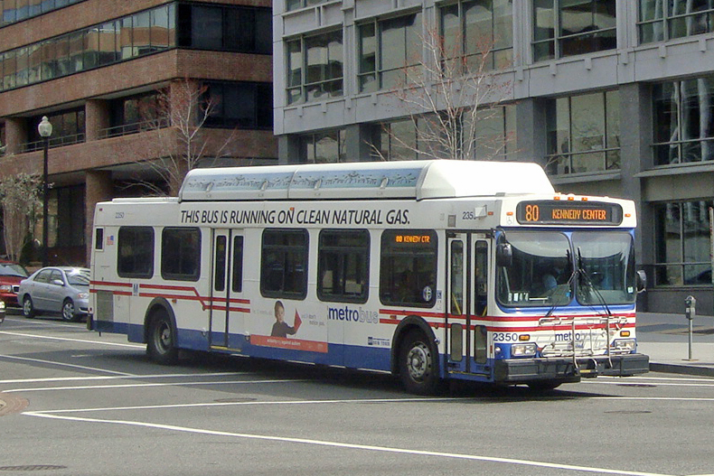
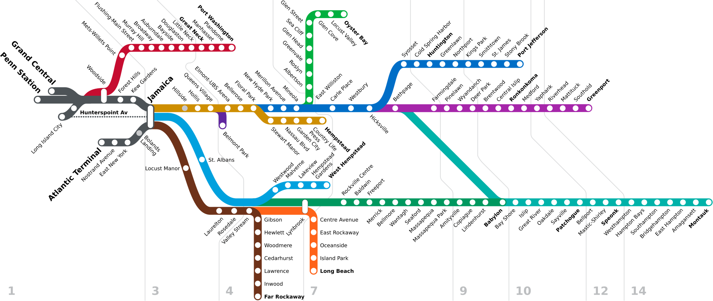
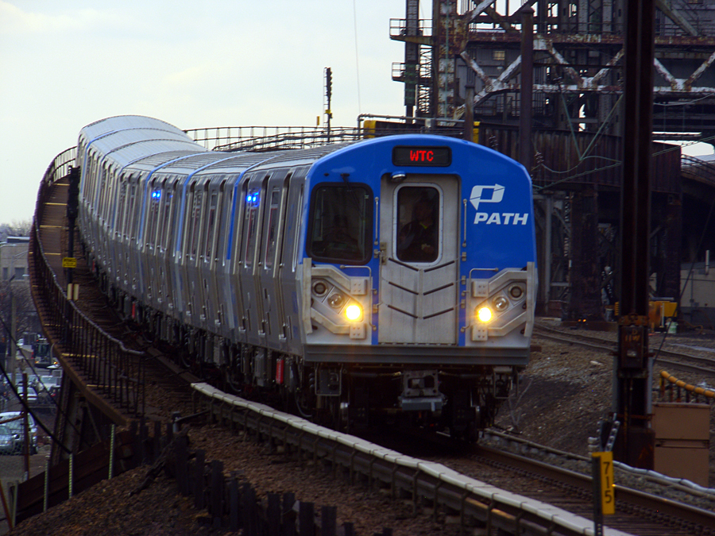
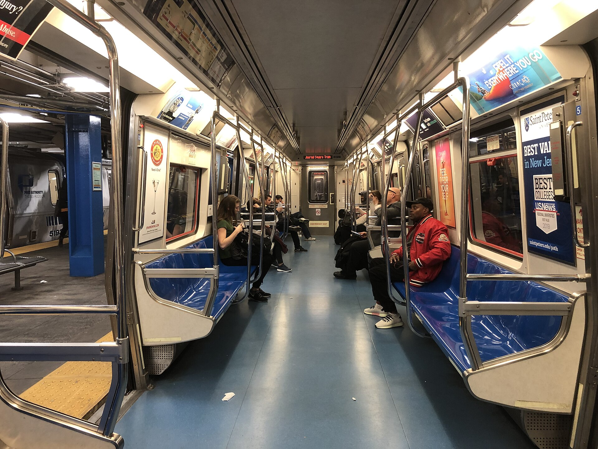

---
title: "Mini-Project #02: Green Transit Awards"
author: "Yuqin Zheng"
format:
  html:
    toc: true
    toc-location: right
    theme: cosmo
    css: mp02-styles.css
    code-fold: true
    code-summary: "Show R Code"
execute:
  warning: false
  message: false
---
# Project Overview

This project evaluates the environmental performance of U.S. public transit agencies by synthesizing national energy consumption records, passenger service metrics, and state-level electricity profiles. Through emissions calculations and passenger-service normalization, the analysis estimates carbon dioxide emissions, benchmarks environmental efficiency across agencies, and identifies preliminary winners for the 2025 Green Transit Awards.

# Data Acquisition 
  
## Task 1a: State Electricity Profiles
```{r}
#| include: false

library(tidyverse)
library(stringr)
library(httr2)
library(rvest)
```

```{r}
#| echo: true
#| code-fold: true
#| code-summary: "Show Data Acquisition Code"
get_eia_sep <- function(state, abbr){
    library(tidyverse)
    library(stringr)
    library(httr2)
    library(rvest)
    library(fs)
  
    state_formatted <- str_to_lower(state) |> str_replace_all("\\s", "")
    
    dir_name <- fs::path("data", "mp02")
    file_name <- fs::path(dir_name, state_formatted)
    
    fs::dir_create(dir_name, recurse=TRUE)
    
    if(!fs::file_exists(file_name)){
        BASE_URL <- "https://www.eia.gov"
        RESPONSE <- request(BASE_URL) |> 
          req_url_path("electricity", 
                       "state", 
                       state_formatted) |>
          req_headers(
            `User-Agent` = "Mozilla/5.0 (Macintosh; Intel Mac OS X 10.15; rv:149.0) Gecko/20100101 Firefox/149.0"
            ) |>   
          req_retry(
                max_tries = 4, 
          ) |>
          req_perform(file_name)
    
        resp_check_status(RESPONSE)
    }
    
    TABLE <- read_html(file_name) |> 
        html_element("table") |> 
        html_table() |>
        mutate(Item = str_to_lower(Item))
    
    if("U.S. rank" %in% colnames(TABLE)){
        TABLE <- TABLE |> rename(Rank = `U.S. rank`)
    }
    
    CO2_MWh <- TABLE |> 
        filter(Item == "carbon dioxide (lbs/mwh)") |>
        pull(Value) |> 
        str_replace_all(",", "") |>
        as.numeric()
    
    PRIMARY <- TABLE |> 
        filter(Item == "primary energy source") |> 
        pull(Rank)
    
    RATE <- TABLE |>
        filter(Item == "average retail price (cents/kwh)") |>
        pull(Value) |>
        as.numeric()
    
    GENERATION_MWh <- TABLE |>
        filter(Item == "net generation (megawatthours)") |>
        pull(Value) |>
        str_replace_all(",", "") |>
        as.numeric()
    
    data.frame(CO2_MWh               = CO2_MWh, 
               primary_source        = PRIMARY,
               electricity_price_MWh = RATE * 10, # / 100 cents to dollars &
               # * 1000 kWh to MWH 
               generation_MWh        = GENERATION_MWh, 
               state                 = state, 
               abbreviation          = abbr
    )
}

EIA_SEP_REPORT <- map2(state.name, state.abb, get_eia_sep) |> list_rbind()
```
By doing these steps, we collected state-level electricity data from the U.S. Energy Information Administration (EIA) using the provided R function. The resulting dataset, `EIA_SEP_REPORT`, contains 50 observations and 6 variables, including CO₂ emissions per MWh, primary energy source, electricity price, and total electricity generation.

This dataset will help us estimate the environmental impact of electricity consumption by public transit systems across different states. 


::: {.callout-note title="Data Management" appearance="minimal"}
The downloaded files were stored locally and excluded from Git tracking using `.gitignore`.
:::

## Task 1b: NTD Energy Usage
```{r}
#| echo: true
#| code-fold: true
#| code-summary: "Show NTD Energy Acquisition Code"

load_ntd_energy <- function(){
  library(readxl)
  library(httr2)
  library(tidyverse)
  library(fs)
  
  # Create 'data/mp02' directory if not already present
  DATA_DIR <- fs::path("data", "mp02")
  fs::dir_create(DATA_DIR, recurse=TRUE)

  NTD_ENERGY_FILE <- fs::path(DATA_DIR, "2025_ntd_energy.xlsx")

  if(!fs::file_exists(NTD_ENERGY_FILE)){
    library(httr2)
  
    request("https://www.transit.dot.gov/") |>
      req_url_path("sites",
                   "fta.dot.gov",
                   "files",
                   "2026-09",
                   "2025 Energy Consumption_260806.xlsx") |> 
      req_headers(
        `User-Agent` = "Mozilla/5.0 (Macintosh; Intel Mac OS X 10.15; rv:149.0) Gecko/20100101 Firefox/149.0") |> 
      req_perform(NTD_ENERGY_FILE)
  }
  
  if(file.info(NTD_ENERGY_FILE)$size < 1e4){
        cat("I was unable to download the NTD Energy File. Please try again.\n")
        stop("Download failed. Please delete the corrupted file by running `unlink('data/mp02/2025_ntd_energy.xlsx')` and try again.")
    }

  to_numeric_fill_0 <- function(x){
    x <- if_else(x == "-", NA, x)
    replace_na(as.numeric(x), 0)
  }

  read_excel(NTD_ENERGY_FILE) |> 
    select(-c(`Reporter Type`, 
              `Reporting Module`, 
              `Gallons of Other Fuel`, 
              `Other Fuel Description`)) |>
    mutate(across(-c(`Agency Name`, 
                     `Mode`,
                     `TOS`), 
                  to_numeric_fill_0)) |>
    group_by(`NTD ID`, `Mode`, `Agency Name`) |>
    summarize(across(where(is.numeric), sum), 
              .groups = "keep") |>
    mutate(ENERGY = sum(c_across(c(where(is.numeric))))) |>
    filter(ENERGY > 0) |>
    select(-ENERGY) |>
    ungroup()
}

NTD_ENERGY <- load_ntd_energy()
```
I downloaded the 2025 Energy Consumption dataset from the National Transit Database (NTD) and used the readxl packagde to import it into R.

After cleaning the data and grouping it by transit agency and transportation mode, I got **1,134** rows and **16** columns in `NTD_ENERGY`. The dataset includes information about diesel, gasoline, electricity.

The mode column is important because one agency may operate multiple types of transportation, such as buses and subways. Keeping them separate will help to compair their energy consumptions more accurately.

I also checked for missing values and found none in the clean dataset. However, some missing or non-numeric values were replaced with 0 during the cleaning process.

## Task 1c: NTD Transit Service Provided
```{r}
#| echo: true
#| code-fold: true
#| code-summary: "Show NTD Service Acquisition Code"

load_ntd_service <- function(){
  library(httr2)
  library(tidyverse)
  library(fs)
  
  # Create 'data/mp02' directory if not already present
  DATA_DIR <- fs::path("data", "mp02")
  fs::dir_create(DATA_DIR, recurse=TRUE)

  NTD_SERVICE_FILE <- fs::path(DATA_DIR, "2025_ntd_service.csv")

  if(!fs::file_exists(NTD_SERVICE_FILE)){
    library(httr2)
  
    request("https://data.transportation.gov/resource/4fir-qbim.csv") |>
      req_url_query(`$query`=paste(
        "SELECT  `_5_digit_ntd_id` AS `NTD_ID`", 
        "`max_agency` AS `AGENCY`",
        "`max_reporter_type` AS `reporter_type`",
        "`max_organization_type` AS `organization_type`",
        "`max_city` AS `city`",
        "`max_state` AS `state`",
        "`mode`",
        "`type_of_service`",
        "`max_primary_uza_code` as `uza_code`",
        "`max_primary_uza_name` as `uza_name`",
        "`max_primary_uza_area_sq_miles` as `uza_sq_miles`",
        "`max_primary_uza_population` as `uza_population`",
        "`max_service_area_sq_miles` as `service_area_sq_miles`",
        "`max_service_area_population` as `service_area_population`",
        "`questionable_record` as `flagged_likely_inaccurate`",
        "`sum_unlinked_passenger_trips_upt` as `total_upt`",
        "`sum_passenger_miles` WHERE caseless_one_of(`report_year`, '2025') limit 50000", 
        sep=",")) |>
      req_headers(
        `User-Agent` = "Mozilla/5.0 (Macintosh; Intel Mac OS X 10.15; rv:149.0) Gecko/20100101 Firefox/149.0") |> 
      req_perform(NTD_SERVICE_FILE)
  }
  
  if(file.info(NTD_SERVICE_FILE)$size < 1e4){
        cat("I was unable to download the NTD Service File. Please try again.\n")
        stop("Download failed. Please delete the corrupted file by running `unlink('data/mp02/2025_ntd_service.xlsx')` and try again.")
    }

  read_csv(NTD_SERVICE_FILE) |>
    mutate(flagged_likely_inaccurate = !is.na(flagged_likely_inaccurate))
}

NTD_SERVICE <- load_ntd_service()

```
I downloaded the 2025 transit service data from the National Transit Database (NTD) and imported it into R using read_csv().

The resulting dataset, `NTD_SERVICE`, contains **3,762** rows and **17** columns. It includes information about transit agencies, transportation modes, passenger trips (total_upt), and passenger miles traveled (sum_passenger_miles).

I also checked for missing values and found that sum_passenger_miles has **2,437** missing values, while total_upt has none. In addition, **117** records were flagged as potentially inaccurate. These issues should be considered in the later analysis.

This dataset will help evaluate the environmental efficiency of different public transit systems in the U.S.

# Data Cleaning and Preparation

## Task 2: Recoding Transit Modes
```{r}
#| echo: true
#| code-fold: true
#| code-summary: "Show Mode Inspection Code"

# Inspect original mode codes in both datasets
energy_mode_codes <- NTD_ENERGY |>
  distinct(Mode) |>
  arrange(Mode)

service_mode_coded <- NTD_SERVICE |>
  distinct(mode) |>
  arrange(mode)
```

```{r}
#| echo: true
#| code-fold: true
#| code-summary: "Show Mode Recoding Code"

recode_mode <- function(x) {
  recode_values(
    x,
    "AR" ~ "Alaska Railroad",
    "CB" ~ "Commuter Bus",
    "CC" ~ "Cable Car",
    "CR" ~ "Commuter Rail",
    "DR" ~ "Demand Response",
    "DT" ~ "Demand Response - Taxi",
    "FB" ~ "Ferryboat",
    "HR" ~ "Heavy Rail",
    "IP" ~ "Inclined Plane",
    "JT" ~ "Jitney",
    "LR" ~ "Light Rail",
    "MB" ~ "Bus",
    "MG" ~ "Monorail/Automated Guideway",
    "OR" ~ "Other",
    "PB" ~ "Publico",
    "RB" ~ "Bus Rapid Transit",
    "SR" ~ "Streetcar Rail",
    "TB" ~ "Trolleybus",
    "TR" ~ "Aerial Tramway",
    "VP" ~ "Vanpool",
    "YR" ~ "Hybrid Rail",
    default = "Unknown"
  )
}

NTD_ENERGY <- NTD_ENERGY |>
  mutate(Mode = recode_mode(Mode))

NTD_SERVICE <- NTD_SERVICE |>
  mutate(mode = recode_mode(mode))
```
```{r}
#| echo: true
#| code-fold: true
#| code-summary: "Show Mode Validation Code"

# Validate mode recoding
mode_validation <- tibble(
  Dataset = c("NTD Energy", "NTD Service"),
  distinct_modes = c(
    n_distinct(NTD_ENERGY$Mode),
    n_distinct(NTD_SERVICE$mode)
  ),
  unknown_records = c(
    sum(NTD_ENERGY$Mode == "Unknown", na.rm = TRUE),
    sum(NTD_SERVICE$mode == "Unknown", na.rm = TRUE)
  )
)

# Display validation summary
mode_validation |>
  gt::gt() |>
  gt::tab_header(
    title = "Transit Mode Recoding Validation",
    subtitle = "2025 NTD Energy and Service Datasets"
  ) |>
  gt::cols_label(
    Dataset = "Dataset",
    distinct_modes = "Distinct Modes",
    unknown_records = "Unknown Records"
  ) |>
  gt::cols_align(
    align = "center",
    columns = c(distinct_modes, unknown_records)
  ) |>
  gt::tab_options(
    heading.background.color = "#EAF5EE",
    column_labels.background.color = "#EAF5EE",
    table.border.top.color = "#174D3A",
    table.border.bottom.color = "#174D3A",
    table.font.size = gt::px(14),
    data_row.padding = gt::px(10)
  )
```


I used `dinstinct()` to check the tranportation mode codes in both NTD datasets and looked up their meanings in the NTD documentation.

Then I used `recode_values()` to replace the two-letter codes with full names. After recoding, both datasets contain 17 different transportation mode, with no `"Unknown"` values. This makes the data easier to understand and compare for the further analysis.

# Data Integration and Initial Exploration

## Task 3a: ETA State Electricity Profiles

### List Five States with the Dirtiest Electricity Mix

```{r}
#| echo: true
#| code-fold: true
#| code-summary: "Show the Code"

dirtiest_5 <- EIA_SEP_REPORT |>
  arrange(desc(CO2_MWh)) |>
  slice_head(n=5) |>
  select(state, CO2_MWh, primary_source)

dirtiest_5 |>
  gt::gt() |>
  gt::tab_header(
    title = "Five States with the Dirtiest Electricity Mix",
    subtitle = "CO₂ Emissions per MWh of Electricity Generated"
  ) |>
  gt::cols_label(
    state = "State",
    CO2_MWh = "CO₂ (lbs/MWh)",
    primary_source = "Primary Energy Source"
  ) |>
  gt::fmt_number(
    columns = CO2_MWh,
    decimals = 0
  ) |>
  gt::tab_source_note(
    source_note = "Source: U.S. Energy Information Administration"
  )

```


:::: {.columns-margin}

{width="100%"}

*Harpers Ferry, West Virginia.*

:::
**Answer**: `West Virginia` has the highest carbon emission intensity among all of the states at `r scales::comma(dirtiest_5 |> filter(state == "West Virginia") |> pull(CO2_MWh), accuracy = 1)` lbs/MWh. Additionally, four out of the top five states rely primarily on coal, while Hawaii being the sole exception as it uses petroleum.

### Average CO₂ Emissions per MWh in the US
```{r}
#| echo: true
#| cold-fold: true
#| code-summary: "Show the Calculation"

us_avg_co2 <- EIA_SEP_REPORT |>
  summarize(
    weighted_avg = weighted.mean(
      CO2_MWh,
      w = generation_MWh,
      na.rm = TRUE
    )
  ) |>
  pull(weighted_avg)

```

**Answer**: The avaerage CO₂ Emissions is approximately `r scales::comma(us_avg_co2, accuracy = 0.01)` per MWh in the US. 

### How Much Cleaner Is New York's Energy Mix Compared to Texas?
```{r}
#| echo: true
#| code-fold: true
#| code-summary: "Show the Calculation"

ny_co2 <- EIA_SEP_REPORT |>
  filter(abbreviation == "NY") |>
  pull(CO2_MWh)

tx_co2 <- EIA_SEP_REPORT |>
  filter(abbreviation == "TX") |>
  pull(CO2_MWh)

ny_vs_tx_ratio <- tx_co2 / ny_co2

```
**Answer**: Texas's carbon emission is `r round(tx_co2, 2)`/MWh while New York's carbon emission is `r round(ny_co2, 2)`/MWh. Texas's Energy Mix has `r round(ny_vs_tx_ratio, 2)` times as much as New York's energy mix. Therefore, we could say New York has much lower carbon emissions than Texas.

## Task 3b: NTD Energy Usage

### Top 5 Transit Agencies by Fuel Consumption
```{r}
#| echo: true
#| code-fold: true
#| code-summary: "Show the Code"

# Calculate total gallons by transit agency
top_5_fuel_agencies <- NTD_ENERGY |>
  group_by(`NTD ID`, `Agency Name`) |>
  summarize(
    across(
      starts_with("Gallons of "),
      ~sum(.x, na.rm = TRUE)
    ),
    .groups = "drop"
  ) |>
  mutate(
    total_gallons = rowSums(
      pick(starts_with("Gallons of "))
    )
  ) |>
  arrange(desc(total_gallons)) |>
  slice_head(n = 5)

# Break down fuel consumption by type
fuel_breakdown <- top_5_fuel_agencies |>
  pivot_longer(
    cols = starts_with("Gallons of "),
    names_to = "fuel_type",
    values_to = "gallons"
  ) |>
  filter(gallons > 0) |>
  mutate(
    fuel_type = str_remove(fuel_type, "^Gallons of "),
    share = gallons / total_gallons,
    agency_label = paste0(
      `Agency Name`,
      " | Total: ",
      scales::comma(total_gallons),
      " gallons"
    )
  ) |>
  arrange(desc(total_gallons), desc(gallons)) |>
  select(agency_label, fuel_type, gallons, share)

# Create table
fuel_table <- top_5_fuel_agencies |>
  mutate(
    other_gallons = total_gallons -
      `Gallons of Diesel Fuel` -
      `Gallons of Gasoline` -
      `Gallons of Compressed Natural Gas`
  ) |>
  transmute(
    Agency = case_when(
      `Agency Name` == "New Jersey Transit Corporation" ~ "NJ Transit",
      `Agency Name` == "MTA New York City Transit" ~ "MTA NYC Transit",
      `Agency Name` == "Los Angeles County Metropolitan Transportation Authority" ~ "LA Metro",
      `Agency Name` == "Northeast Illinois Regional Commuter Railroad Corporation" ~ "Metra",
      `Agency Name` == "Massachusetts Bay Transportation Authority" ~ "MBTA",
      TRUE ~ `Agency Name`
    ),
    Diesel = `Gallons of Diesel Fuel`,
    Gasoline = `Gallons of Gasoline`,
    CNG = `Gallons of Compressed Natural Gas`,
    Other = other_gallons,
    Total = total_gallons
  )

fuel_table |>
  mutate(
    across(
      c(Diesel, Gasoline, CNG, Other),
      ~ paste0(
        scales::number(.x / 1e6, accuracy = 0.01),
        " (",
        scales::percent(.x / Total, accuracy = 0.1),
        ")"
      )
    ),
    Total = Total / 1e6
  ) |>
  gt::gt() |>
  gt::tab_header(
    title = "Top 5 Transit Agencies by Fuel Consumption",
    subtitle = "2025 Fuel Usage: Million Gallons (Share %)"
  ) |>
  gt::cols_label(
    Agency = "Transit Agency",
    Diesel = "Diesel",
    Gasoline = "Gasoline",
    CNG = "CNG",
    Other = "Other Fuels",
    Total = "Total"
  ) |>
  gt::fmt_number(
    columns = Total,
    decimals = 2
  ) |>
  gt::tab_style(
    style = gt::cell_text(weight = "bold"),
    locations = gt::cells_body(columns = Total)
  ) |>
  gt::tab_options(
    heading.background.color = "#EAF5EE",
    column_labels.background.color = "#D6EADC",
    table.border.top.color = "#174D3A",
    table.border.bottom.color = "#174D3A",
    table.font.size = "small"
  ) |>
  gt::tab_source_note(
    source_note = paste(
      "Source: National Transit Database,",
      "2025 Energy Consumption.",
      "Electricity and hydrogen excluded.",
      "Percentages based on gallons used."
    )
  )
```
**Findings**:`NJ Transit` ranks first in total fuel consumption, with `MTA NYC Transit` closely following in second place. Four out of the five transit agencies rely primarily on diesel for their operations. A notable exception is `LA Metro`, which has a completely different fuel structure and relies almost entirely on CNG. **However, high fuel consumption does not necessarily mean poor environmental efficiency, as true environmental performance depends heavily on ridership, service mileage, and fuel emission factors.**

### Fuel Consumption by Type Across US Public Transit
```{r}

#| echo: true
#| code-fold: true
#| code-summary: "Show the Code"
#| fig-width: 10
#| fig-height: 7

fuel_totals <- NTD_ENERGY |>
  select(matches(
    "^(Gallons of |Kilowatt hours of |Kilograms of )"
  )) |>
  pivot_longer(
    cols = everything(),
    names_to = "fuel_type",
    values_to = "amount"
  ) |>
  mutate(
    unit = case_when(
      str_starts(fuel_type, "Gallons of ") ~ "Gallons",
      str_starts(fuel_type, "Kilowatt hours of ") ~ "kWh",
      str_starts(fuel_type, "Kilograms of ") ~ "Kilograms"
    ),
    fuel_type = str_remove(
      fuel_type,
      "^(Gallons of |Kilowatt hours of |Kilograms of )"
    )
  ) |>
  group_by(unit, fuel_type) |>
  summarize(
    total_amount = sum(amount, na.rm = TRUE),
    .groups = "drop"
  ) |>
  filter(total_amount > 0)

# Create a separate plot for each unit
library(patchwork)

short_num <- scales::label_number(
  scale_cut = scales::cut_short_scale(),
  accuracy = 0.1
)

make_panel <- function(unit_name, plot_title, color) {

  plot_data <- fuel_totals |>
    filter(unit == unit_name)

  ggplot(
    plot_data,
    aes(
      x = total_amount,
      y = reorder(fuel_type, total_amount)
    )
  ) +
    geom_col(
      fill = color,
      width = 0.65
    ) +
    geom_text(
      aes(label = short_num(total_amount)),
      hjust = -0.15,
      size = 3.5,
      color = "#174D3A"
    ) +
    scale_x_continuous(
      limits = c(
        0,
        max(plot_data$total_amount) * 1.22
      ),
      expand = expansion(mult = c(0, 0))
    ) +
    labs(
      title = plot_title,
      x = NULL,
      y = NULL
    ) +
    theme_minimal(base_size = 12) +
    theme(
      plot.title = element_text(
        face = "bold",
        color = "#174D3A",
        size = 14
      ),
      axis.text.y = element_text(size = 11),
      axis.text.x = element_blank(),
      axis.ticks.x = element_blank(),
      panel.grid = element_blank(),
      plot.margin = margin(10, 15, 10, 10)
    )
}

p_fuel <- make_panel(
  "Gallons",
  "Fuel Consumption (Gallons)",
  "#2F7253"
)

p_electric <- make_panel(
  "kWh",
  "Electricity Consumption (kWh)",
  "#689D7E"
)

# Final visualization: two clean panels
(p_fuel / p_electric) +
  plot_layout(
    heights = c(3.5, 1.2)
  ) +
  plot_annotation(
    caption = paste(
      "Source: National Transit Database,",
      "2025 Energy Consumption.",
      "Different units are not directly comparable."
    ),
    theme = theme(
      plot.caption = element_text(
        size = 9,
        color = "#64756B"
      )
    )
  )
```

::: {.callout-tip title="Hydrogen Consumption" appearance="minimal"}
Total hydrogen consumption in 2025: **`r scales::label_number(scale_cut = scales::cut_short_scale(), accuracy = 0.1)(fuel_totals |> filter(fuel_type == "Hydrogen", unit == "Kilograms") |> pull(total_amount))` kg**.
:::
:::: {.columns}

::: {.column width="50%"}

{width="100%"}

:::

::: {.column width="50%"}

{width="100%"}

:::

::::
**Findings**: `Diesel fuel` had the highest consumption by volume, reaching more than twice the amount of `CNG`. Meanwhile, electric propulsion accounted for the vast majority of reported electricity consumption compared to electric batteries. **However, different energy sources are measured in varying units, meaning total consumption cannot be directly compared to judge environmental impact. Ultimately, emission factors and passenger service levels must be considered to fairly evaluate overall environmental efficiency for the awards.**

## Task 3c: NTD Transit Service Data

### Top 5 Transit Services by Annual UPT

```{r}
#| echo: true
#| code-fold: true
#| code-summary: "Show the Code"
#| fig-width: 10
#| fig-height: 5.5

# Find the five transit services with the highest UPT

top_5_upt <- NTD_SERVICE |>
  group_by(NTD_ID, AGENCY, mode, type_of_service) |>
  summarize(
    total_upt = sum(total_upt, na.rm = TRUE),
    flagged = any(flagged_likely_inaccurate),
    .groups = "drop"
  ) |>
  arrange(desc(total_upt)) |>
  slice_head(n = 5) |>
  mutate(
    agency_short = case_when(
      str_detect(AGENCY, "^MTA New York City Transit") ~ "MTA NYC",
      str_detect(AGENCY, "^Los Angeles County Metropolitan") ~ "LA Metro",
      str_detect(AGENCY, "^Chicago Transit Authority") ~ "Chicago CTA",
      str_detect(AGENCY, "^Washington Metropolitan") ~ "Washington Metro",
      TRUE ~ AGENCY
    ),
    service_label = paste0(
      agency_short, " - ", mode,
      " (", type_of_service, ")"
    ),
    upt_millions = total_upt / 1e6,
    upt_label = if_else(
      total_upt >= 1e9,
      paste0(scales::number(total_upt / 1e9, accuracy = 0.01), "B"),
      paste0(scales::number(total_upt / 1e6, accuracy = 0.1), "M")
    )
  )

# Create visualization

top_5_upt |>
  ggplot(aes(
    x = upt_millions,
    y = forcats::fct_reorder(service_label, upt_millions)
  )) +
  geom_col(
    fill = "#2F7253",
    width = 0.65
  ) +
  geom_text(
    aes(label = upt_label),
    hjust = -0.15,
    color = "#174D3A",
    size = 4
  ) +
  scale_x_continuous(
    limits = c(0, max(top_5_upt$upt_millions) * 1.2),
    labels = scales::label_number(
      accuracy = 1,
      big.mark = ","
    ),
    expand = expansion(mult = c(0, 0))
  ) +
  labs(
    x = "Unlinked Passenger Trips (Millions)",
    y = NULL,
    caption = "Source: National Transit Database, 2025 Service by Agency"
  ) +
  theme_minimal(base_size = 12) +
  theme(
    axis.text.y = element_text(
      size = 11,
      color = "#263B30"
    ),
    axis.text.x = element_text(
      size = 10
    ),
    axis.title.x = element_text(
      size = 11
    ),
    panel.grid.major.y = element_blank(),
    panel.grid.minor = element_blank(),
    plot.caption = element_text(
      color = "#64756B",
      size = 9
    ),
    plot.margin = margin(15, 20, 10, 10)
  )
```
**Findings**: MTA NYC Heavy Rail ranks first with the highest annual UPT of approximately 2.32 billion, followed by MTA NYC Bus in second place. The top five transit services consist of three bus systems and two heavy rail systems, with MTA services showing significantly higher ridership than the others. However, high passenger volume does not necessarily mean greater environmental friendliness, as overall impact must be evaluated by combining energy consumption and carbon emissions.

### Average Trip Length on MTA NYC

```{r}
#| echo: true
#| code-fold: true
#| code-summary: "Show MTA NYC Calculation Code"

# 1. Select MTA NYC service records
mta_nyc <- NTD_SERVICE |>
  dplyr::filter(AGENCY == "MTA New York City Transit")

# Check that the agency exists
if (nrow(mta_nyc) == 0) {
  stop("No MTA New York City Transit records found.")
}

# 2. Data quality checks
mta_nyc_check <- mta_nyc |>
  dplyr::summarise(
    records = dplyr::n(),
    missing_passenger_miles = sum(
      is.na(sum_passenger_miles)
    ),
    upt_without_miles = sum(
      total_upt > 0 & is.na(sum_passenger_miles),
      na.rm = TRUE
    ),
    flagged_records = sum(
      flagged_likely_inaccurate,
      na.rm = TRUE
    )
  )

# 3. Calculate average trip length
mta_avg_trip <- mta_nyc |>
  dplyr::summarise(
    avg_trip_length =
      sum(sum_passenger_miles, na.rm = TRUE) /
      sum(total_upt, na.rm = TRUE)
  )

# 4. Create a summary table
mta_quality_table <- tibble::tibble(
  Check = c(
    "Service records",
    "Missing passenger-mile values",
    "UPT without passenger miles",
    "Flagged records"
  ),
  Value = c(
    mta_nyc_check$records[1],
    mta_nyc_check$missing_passenger_miles[1],
    mta_nyc_check$upt_without_miles[1],
    mta_nyc_check$flagged_records[1]
  )
)

# 5. Display the GT table
mta_quality_table |>
  gt::gt() |>
  gt::tab_header(
    title = "MTA NYC Data Quality Summary",
    subtitle = "2025 NTD Service by Agency"
  ) |>
  gt::cols_label(
    Check = "Data Quality Check",
    Value = "Value"
  ) |>
  gt::cols_align(
    align = "center",
    columns = Value
  ) |>
  gt::tab_options(
    heading.background.color = "#EAF5EE",
    column_labels.background.color = "#EAF5EE",
    table.border.top.color = "#174D3A",
    table.border.bottom.color = "#174D3A",
    table.font.size = gt::px(14)
  )
```

::: {.callout-note appearance="simple"}
### Key Finding

The estimated average trip length for **MTA New York City Transit** is  
**`r sprintf("%.2f", mta_avg_trip$avg_trip_length[1])` miles per trip**.

This estimate is calculated as total passenger miles divided by total unlinked passenger trips.
:::

The result suggests that the average reported trip on MTA New York City Transit was about `r sprintf("%.2f", mta_avg_trip$avg_trip_length[1])` miles. The supporting data include `r mta_nyc_check$records[1]` service records, with `r mta_nyc_check$flagged_records[1]` flagged record and no cases where UPT was reported without passenger-mile information.


### Are All US States Represented in the NTD Service Data? 
```{r}
#| echo: true
#| code-fold: true
#| code-summary: "Show State Coverage Check Code"

# Create a reference list of all 50 U.S. states
us_states <- tibble::tibble(
  state_name = state.name,
  state_code = state.abb
)

# Find unique states in NTD Service
ntd_states <- NTD_SERVICE |>
  dplyr::distinct(state)

# Identify any missing states
missing_states <- us_states |>
  dplyr::anti_join(
    ntd_states,
    by = c("state_code" = "state")
  )

# Calculate the number of represented states
states_represented <- nrow(us_states) - nrow(missing_states)
```

**Answer:** `r states_represented` out of 50 U.S. states are represented in the NTD Service data. There are `r nrow(missing_states)` missing states.

`r if (nrow(missing_states) > 0) paste0("Missing states: ", paste(missing_states$state_name, collapse = ", "), ".") else ""`

# Data Analysis

## Task 5: Calculate Total CO₂ Emissions
```{r}

#| echo: true
#| code-fold: true
#| code-summary: "Show Data Integration Code"

# Step 1: Prepare agency and mode lookup
service_state <- NTD_SERVICE |>
  distinct(NTD_ID, mode, state)

# Check whether one agency + mode has multiple states
state_conflicts <- service_state |>
  count(NTD_ID, mode) |>
  filter(n > 1)

if (nrow(state_conflicts) > 0) {
  stop("Some Agency + Mode pairs have multiple states.")
}

# Step 2: Standardize NTD IDs in energy data
energy_for_join <- NTD_ENERGY |>
  mutate(
    NTD_ID = sprintf("%05d", as.integer(`NTD ID`))
  )

# Step 3: Join energy and service data
transit_joined <- energy_for_join |>
  left_join(
    service_state,
    by = c("NTD_ID", "Mode" = "mode"),
    relationship = "many-to-one"
  ) |>
  left_join(
    EIA_SEP_REPORT |>
      select(abbreviation, CO2_MWh),
    by = c("state" = "abbreviation"),
    relationship = "many-to-one"
  )
# Fill missing CO2 factors for DC and PR

transit_joined <- transit_joined |>
  mutate(
    electricity_factor_source = case_when(
      !is.na(CO2_MWh) ~ "EIA 2024",
      state == "DC" ~ "EPA eGRID 2023 - RFCE",
      state == "PR" ~ "EPA eGRID 2023 - PRMS",
      TRUE ~ "Unknown"
    ),
    CO2_MWh = case_when(
      !is.na(CO2_MWh) ~ CO2_MWh,
      state == "DC" ~ 596.904,
      state == "PR" ~ 1543.073,
      TRUE ~ NA_real_
    )
  )


# Step 4: Check joined data
join_check <- transit_joined |>
  summarize(
    rows = n(),
    missing_state = sum(is.na(state)),
    missing_co2_factor = sum(is.na(CO2_MWh))
  )

```
```{r}

#| echo: true
#| code-fold: true
#| code-summary: "Show Emissions Calculation Code"

# Unit conversion
kg_to_lbs <- 2.20462262

# CNG: assume reported gallon equivalents are GGE
cng_lbs_per_gge <- 0.05444 * 123.57 * kg_to_lbs

emissions_by_mode <- transit_joined |>
  mutate(
    # Combustion emissions in pounds of CO2
    combustion_co2_lbs =
      `Gallons of Diesel Fuel` * 22.45 +
      `Gallons of Gasoline` * 18.73 +
      `Gallons of Bio-Diesel` * (9.45 * kg_to_lbs) +
      `Gallons of Bunker Fuel` * 24.78 +
      `Gallons of Compressed Natural Gas` * cng_lbs_per_gge +
      `Gallons of Ethanol` * (5.75 * kg_to_lbs) +
      `Gallons of Kerosene` * 21.78 +
      `Gallons of Liquified Nat Gas` * (4.50 * kg_to_lbs) +
      `Gallons of Liquified Petroleum Gas` * 12.68,

    # Electricity consumption in kWh
    electricity_kwh =
      `Kilowatt hours of Electric Battery` +
      `Kilowatt hours of Electric Propulsion`,

    # Electricity-related CO2 emissions
    electricity_co2_lbs = if_else(
      electricity_kwh == 0,
      0,
      electricity_kwh / 1000 * CO2_MWh
    ),

    # Hydrogen: zero direct CO2 at point of use
    hydrogen_co2_lbs = 0 * `Kilograms of Hydrogen`,

    # Total emissions
    total_co2_lbs =
      combustion_co2_lbs +
      electricity_co2_lbs +
      hydrogen_co2_lbs,

    # Convert pounds to metric tons
    total_co2_metric_tons =
      total_co2_lbs / 2204.62262
  )

```
### Methodology and Key Findings 
I used `left_join()` to connected the three datasets using agency ID, transportation mode, followed by state-level electricity emission factors. Each row represents a unique agency and transportation mode combination.

Total estimated CO₂ emissions were calculated by combining direct fuel combustion with electricity-related emissions, converting `kWh` to `MWh` and multiplying by state-level electricity emission factors.

Following data quality checks across `r scales::comma(nrow(emissions_by_mode))` agency-mode pairs, the analysis produced a preliminary estimate of `r round(sum(emissions_by_mode$total_co2_metric_tons) / 1e6, 2)` million metric tons of total CO₂, with no missing values in the final emissions calculations.

However, several limitations apply to this preliminary estimate, including GGE conversion assumptions for CNG, varying bio-diesed blend ratios, regional EPA estimations for DC and Puerto Rico, and treating hydrogen as having zero direct tailpipe emissions.

## Task 6: Normalize Emissions to Transit Usage

### Agency-Level Data Preparation
```{r}
#| echo: true
#| code-fold: true
#| code-summary: "Show Agency-Level Aggregation Code"

# Aggregate emissions across transportation modes

agency_emissions <- emissions_by_mode |>
  group_by(NTD_ID) |>
  summarize(
    Agency = first(`Agency Name`),
    number_of_modes = n_distinct(Mode),
    total_co2_lbs = sum(total_co2_lbs),
    .groups = "drop"
  )


# Aggregate passenger service by agency

agency_service <- NTD_SERVICE |>
  group_by(NTD_ID) |>
  summarize(
    agency_upt = sum(total_upt, na.rm = TRUE),

    agency_passenger_miles = if (
      any(is.na(sum_passenger_miles) & total_upt > 0)
    ) {
      NA_real_
    } else {
      sum(sum_passenger_miles, na.rm = TRUE)
    },

    service_records = n(),

    missing_pmt_records = sum(
      is.na(sum_passenger_miles)
    ),

    flagged_records = sum(
      flagged_likely_inaccurate,
      na.rm = TRUE
    ),

    .groups = "drop"
  )

# Check service records without matching energy data
unmatched_by_agency <- NTD_SERVICE |>
  semi_join(agency_emissions, by = "NTD_ID") |>
  anti_join(
    emissions_by_mode |>
      distinct(NTD_ID, Mode),
    by = c("NTD_ID", "mode" = "Mode")
  ) |>
  group_by(NTD_ID) |>
  summarize(
    unmatched_records = n (),
    unmatched_upt = sum(total_upt, na.rm = TRUE),
    .groups = "drop"
  )

# Calculate normalized emissions
agency_efficiency <- agency_emissions |>
  left_join(
    agency_service,
    by = "NTD_ID",
    relationship = "one-to-one"
  ) |>
  left_join(
    unmatched_by_agency,
    by = "NTD_ID",
    relationship = "one-to-one"
  ) |>
  mutate(
    unmatched_records = coalesce(unmatched_records, 0L),
    unmatched_upt = coalesce(unmatched_upt, 0),

    complete_coverage = unmatched_records == 0,

    co2_per_upt = if_else(
      complete_coverage & agency_upt > 0,
      total_co2_lbs / agency_upt,
      NA_real_
    ),

    co2_per_passenger_mile = if_else(
      complete_coverage &
        !is.na(agency_passenger_miles) &
        agency_passenger_miles > 0,
      total_co2_lbs / agency_passenger_miles,
      NA_real_
    )
  )
```
### Methodology for Task 6
I first combined the CO₂ emissions from different transportation modes for each transit agency. Then, I joined the emissions data with passenger service data useing NTD_ID.

To compare agencies of different sizes, I calculated two measures: CO₂ emissions per unlinked passenger trip (UTP) and CO₂ emissions per passenger mile. Both measures were cauculated by dividing total estimated CO₂ emissions in pounds by the corresponding passenger service amount.

Of the `r nrow(agency_efficiency)` agencies, `r sum(!is.na(agency_efficiency$co2_per_upt))` had valid CO₂ per UPT estimates, and `r sum(!is.na(agency_efficiency$co2_per_passenger_mile))` had valid CO₂ per passenger-mile estimates. Agencies with incomplete energy coverage were excluded from these calculations.

For the preliminary rankings, I also excluded flagged agencies and required at least one million annual UPT to reduce the influence of very small transit systems.


### Table 1---Lowest CO₂ per UPT

```{r}
#| echo: true
#| code-fold: true
#| code-summary: "Show CO2 per UPT Ranking Code"

top_upt <- agency_efficiency |>
  filter(
    complete_coverage,
    flagged_records == 0,
    agency_upt >= 1e6,
    !is.na(co2_per_upt)
  ) |>
  arrange(co2_per_upt) |>
  slice_head(n = 5)

top_upt |>
  select(Agency, agency_upt, co2_per_upt) |>
  gt::gt() |>
  gt::tab_header(
    title = "Most Efficient Transit Agencies",
    subtitle = "Lowest CO2 Emissions per UPT, 2025"
  ) |>
  gt::cols_label(
    Agency = "Transit Agency",
    agency_upt = "Annual UPT",
    co2_per_upt = "lbs CO2 / UPT"
  ) |>
  gt::fmt_number(
    columns = agency_upt,
    decimals = 0
  ) |>
  gt::fmt_number(
    columns = co2_per_upt,
    decimals = 4
  ) |>
  gt::tab_options(
    heading.background.color = "#EAF5EE",
    column_labels.background.color = "#D6EADC",
    table.border.top.color = "#174D3A",
    table.border.bottom.color = "#174D3A"
  ) |>
  gt::tab_source_note(
    source_note = paste(
      "Sources: NTD 2025, EIA, and EPA.",
      "Preliminary ranking; minimum 1M UPT,",
      "complete coverage, and no flagged records."
    )
  )
```
### Table 2 ---Lowest CO₂ per Passenger Mile

```{r}
#| echo: true
#| code-fold: true
#| code-summary: "Show CO2 per Passenger Mile Ranking Code"

top_mile <- agency_efficiency |>
  filter(
    complete_coverage,
    flagged_records == 0,
    agency_upt >= 1e6,
    !is.na(co2_per_passenger_mile)
  ) |>
  arrange(co2_per_passenger_mile) |>
  slice_head(n = 5)

top_mile |>
  select(
    Agency,
    agency_passenger_miles,
    co2_per_passenger_mile
  ) |>
  gt::gt() |>
  gt::tab_header(
    title = "Most Efficient Transit Agencies",
    subtitle = "Lowest CO2 Emissions per Passenger Mile, 2025"
  ) |>
  gt::cols_label(
    Agency = "Transit Agency",
    agency_passenger_miles = "Passenger Miles",
    co2_per_passenger_mile = "lbs CO2 / Passenger Mile"
  ) |>
  gt::fmt_number(
    columns = agency_passenger_miles,
    decimals = 0
  ) |>
  gt::fmt_number(
    columns = co2_per_passenger_mile,
    decimals = 4
  ) |>
  gt::tab_options(
    heading.background.color = "#EAF5EE",
    column_labels.background.color = "#D6EADC",
    table.border.top.color = "#174D3A",
    table.border.bottom.color = "#174D3A"
  ) |>
  gt::tab_source_note(
    source_note = paste(
      "Sources: NTD 2025, EIA, and EPA.",
      "Preliminary ranking; minimum 1M UPT,",
      "complete coverage, and no flagged records."
    )
  )
```
### Preliminary Findings & Limitations
Findings: Based on the preliminary rankings, City of Seattle had the lowest estimated CO₂ under both tables, with `0.0575` lbs per UPT and `0.0639` lbs per passenger mile. However, the rankings were not exactly the same, the choice of **normalization** metric may affect the results.

Limitations: The preliminary rankings only include agencies with at least one million annual UPT, complete mode-energy coverage, and no flagged service records. In addition, `City of Seattle's` data only represent its monorail service not the entire city's transit system. And the emissions calculations also rely on fuel conversion assumptions and electricity emission factors. Therefore, these results should be treated as `preliminary` rather than `final award decisions`.

## Task 7: Greenest Transit Awards
```{r}
### Award Eligibility and Selection Criteria

#| echo: true
#| code-fold: true
#| code-summary: "Show Award Eligibility Code"

# Create eligible agency dataset

award_candidates <- agency_efficiency |>
  filter(
    complete_coverage,
    flagged_records == 0,
    agency_upt >= 1e6,
    !is.na(co2_per_upt),
    !is.na(co2_per_passenger_mile),
    agency_passenger_miles > 0
  )

# Summarize eligible agencies and reference values

award_pool_summary <- award_candidates |>
  summarize(
    eligible_agencies = n(),
    median_co2_per_upt = median(co2_per_upt),
    median_co2_per_mile = median(co2_per_passenger_mile),
    min_upt = min(agency_upt),
    max_upt = max(agency_upt)
  )
```

### Award 1: Greenest Transit Agency
```{r}

#| echo: true
#| code-fold: true
#| code-summary: "Show Greenest Transit Award Code"

# Identify the agency with the lowest CO2 per passenger mile

greenest_winner <- award_candidates |>
  slice_min(
    order_by = co2_per_passenger_mile,
    n = 1,
    with_ties = FALSE
  ) |>
  mutate(
    median_co2 = award_pool_summary$median_co2_per_mile,
    percent_below_median =
      (1 - co2_per_passenger_mile / median_co2) * 100
  )
```
::: {.award-summary}

**2025 GREEN TRANSIT AWARDS · PRELIMINARY WINNER**

#### `r greenest_winner$Agency[1]`

:::: {.award-metrics}

::: {.award-metric}

**`r sprintf("%.4f", greenest_winner$co2_per_passenger_mile[1])` lbs**

CO₂ per Passenger Mile

:::

::: {.award-metric}

**`r sprintf("%.4f", greenest_winner$median_co2[1])` lbs**

Eligible Agency Median

:::

::: {.award-metric}

**`r sprintf("%.1f", greenest_winner$percent_below_median[1])`%**

Below Median

:::

::::

*Based on 234 eligible transit agencies in 2025.*

:::


:::: {.columns .seattle-photos}

::: {.column width="49%"}

{width="100%"}

:::

::: {.column width="49%"}

{width="100%"}

:::

::::

*City of Seattle (Monorail / Automated Guideway) — Preliminary Greenest Transit Agency Award Winner, 2025.*

### Award 2: Most Emissions Avoided

```{r}
#| echo: true
#| code-fold: true
#| code-summary: "Show Emissions Avoided Calculation Code"

# Assumptions for the personal driving scenario
cafe_mpg <- 49
gasoline_co2_per_gallon <- 18.73
lbs_per_metric_ton <- 2204.62262

# Calculate hypothetical driving emissions
award2_results <- award_candidates |>
  mutate(
    # Assume one passenger per private vehicle
    hypothetical_driving_miles = agency_passenger_miles,

    # Estimated gasoline consumption
    hypothetical_gallons =
      hypothetical_driving_miles / cafe_mpg,

    # Estimated CO2 emissions from driving
    driving_co2_lbs =
      hypothetical_gallons * gasoline_co2_per_gallon,

    # Net emissions avoided by public transit
    emissions_avoided_lbs =
      driving_co2_lbs - total_co2_lbs,

    # Convert to metric tons
    emissions_avoided_metric_tons =
      emissions_avoided_lbs / lbs_per_metric_ton,

    # Percentage reduction relative to driving
    avoidance_pct =
      100 * emissions_avoided_lbs / driving_co2_lbs
  )

# Identify the agency with the highest net savings
award2_winner <- award2_results |>
  slice_max(
    order_by = emissions_avoided_metric_tons,
    n = 1,
    with_ties = FALSE
  )

# Calculate reference values for Task 8
award2_reference <- award2_results |>
  summarize(
    eligible_agencies = n(),
    median_avoided_tons =
      median(emissions_avoided_metric_tons),
    positive_avoidance_agencies =
      sum(emissions_avoided_metric_tons > 0)
  )

# Keep the five highest-ranking candidates
award2_top5 <- award2_results |>
  arrange(desc(emissions_avoided_metric_tons)) |>
  slice_head(n = 5)

```

```{r}
#| include: false

# Test different MPG assumptions
mpg_sensitivity <- tidyr::crossing(
  award_candidates,
  mpg = c(25, 35, 49)
) |>
  mutate(
    avoided_tons = (
      agency_passenger_miles / mpg * gasoline_co2_per_gallon -
      total_co2_lbs
    ) / lbs_per_metric_ton
  )

# Calculate median avoided emissions
mpg_summary <- mpg_sensitivity |>
  group_by(mpg) |>
  summarize(
    median_avoided = median(avoided_tons),
    positive_agencies = sum(avoided_tons > 0),
    .groups = "drop"
  )

# Identify the winner under each MPG scenario
mpg_winners <- mpg_sensitivity |>
  group_by(mpg) |>
  slice_max(
    avoided_tons,
    n = 1,
    with_ties = FALSE
  ) |>
  ungroup() |>
  select(
    mpg,
    Agency,
    avoided_tons
  )
```
```{r}
#| include: false

# Identify MTA NYC
mta_id <- agency_efficiency |>
  filter(Agency == "MTA New York City Transit") |>
  pull(NTD_ID)

# Identify the flagged transit mode
mta_flagged_modes <- NTD_SERVICE |>
  filter(
    NTD_ID == mta_id,
    flagged_likely_inaccurate
  ) |>
  distinct(mode)

# Scenario 1: Include all MTA services
mta_all_pmt <- NTD_SERVICE |>
  filter(NTD_ID == mta_id) |>
  summarize(pmt = sum(sum_passenger_miles)) |>
  pull(pmt)

mta_all_co2 <- emissions_by_mode |>
  filter(NTD_ID == mta_id) |>
  summarize(co2 = sum(total_co2_lbs)) |>
  pull(co2)

# Scenario 2: Exclude flagged BRT service
mta_clean_pmt <- NTD_SERVICE |>
  filter(
    NTD_ID == mta_id,
    !flagged_likely_inaccurate
  ) |>
  summarize(pmt = sum(sum_passenger_miles)) |>
  pull(pmt)

mta_clean_co2 <- emissions_by_mode |>
  filter(NTD_ID == mta_id) |>
  anti_join(
    mta_flagged_modes,
    by = c("Mode" = "mode")
  ) |>
  summarize(co2 = sum(total_co2_lbs)) |>
  pull(co2)

# Compare the two scenarios
mta_sensitivity <- tibble(
  scenario = c(
    "All MTA services",
    "Excluding flagged BRT"
  ),
  passenger_miles = c(
    mta_all_pmt,
    mta_clean_pmt
  ),
  transit_co2_lbs = c(
    mta_all_co2,
    mta_clean_co2
  )
) |>
  mutate(
    avoided_tons = (
      passenger_miles / cafe_mpg *
        gasoline_co2_per_gallon -
        transit_co2_lbs
    ) / lbs_per_metric_ton
  )

mta_sensitivity
```

::: {.award-summary}

**2025 GREEN TRANSIT AWARDS · PRELIMINARY WINNER**

#### `r award2_winner$Agency[1]`

*Most Emissions Avoided · 49 MPG Driving Scenario*

:::: {.award-metrics}

::: {.award-metric}

**`r format(round(award2_winner$emissions_avoided_metric_tons[1]), big.mark = ",")`**

Metric Tons CO₂ Avoided

:::

::: {.award-metric}

**`r format(round(award2_reference$median_avoided_tons[1]), big.mark = ",")`**

Eligible Agency Median (Metric Tons)

:::

::: {.award-metric}

**`r sprintf("%.1f", award2_winner$avoidance_pct[1])`%**

Less CO₂ Than Driving

:::

::::

*Based on `r nrow(award2_results)` eligible transit agencies in 2025.*

:::


:::: {.columns .award-photos}

::: {.column width="49%"}

{width="100%"}

:::

::: {.column width="49%"}

{width="100%"}

:::

::::

*MTA Long Island Rail Road — Preliminary Most Emissions Avoided Award Winner, 2025.*

### Award 3: Electric Transit Champion
```{r}

#| echo: true
#| code-fold: true
#| code-summary: "Show Electric Transit Champion Code"

# Identify non-electric fuel consumption
electric_agencies <- emissions_by_mode |>
  mutate(
    uses_non_electric = if_any(
      matches("^(Gallons of |Kilograms of )"),
      ~ .x > 0
    )
  ) |>
  group_by(NTD_ID) |>
  summarize(
    uses_non_electric = any(uses_non_electric),
    total_electricity_kwh = sum(electricity_kwh),
    .groups = "drop"
  )

# Identify eligible electricity-only agencies
electric_candidates <- award_candidates |>
  inner_join(
    electric_agencies,
    by = "NTD_ID",
    relationship = "one-to-one"
  ) |>
  filter(
    !uses_non_electric,
    total_electricity_kwh > 0
  ) |>
  arrange(desc(agency_upt))

# Select the winner
electric_winner <- electric_candidates |>
  slice_max(
    agency_upt,
    n = 1,
    with_ties = FALSE
  )

# Calculate reference values
electric_reference <- electric_candidates |>
  summarize(
    eligible_electric_agencies = n(),
    median_upt = median(agency_upt)
  )

```

::: {.award-summary}

**2025 GREEN TRANSIT AWARDS · PRELIMINARY WINNER**

#### `r electric_winner$Agency[1]`

*Electric Transit Champion · Original Award*

:::: {.award-metrics}

::: {.award-metric}

**`r format(round(electric_winner$agency_upt[1]), big.mark = ",")`**

Annual Passenger Trips (UPT)

:::

::: {.award-metric}

**`r format(round(electric_reference$median_upt[1]), big.mark = ",")`**

Electricity-Only Agency Median UPT

:::

::: {.award-metric}

**`r electric_reference$eligible_electric_agencies[1]`**

Eligible Electricity-Only Agencies

:::

::::

*Based on reported 2025 NTD energy and passenger service data.*

:::

:::: {.columns}

::: {.column width="49%"}

{width="100%" fig-align="center"}

:::

::: {.column width="49%"}

{width="100%" fig-align="center"}

:::

::::

*PATH system and service image references.*

# Deliverable: Transit Award "Press Release"

## Task 8: Final Deliverable

### Beyond the Commute: Seattle, LIRR, and PATH Recognized in the 2025 Green Transit Awards

**FOR IMMEDIATE RELEASE**

*Green Transit Awards | November 2026*

Based on the 2025 National Transit Database energy and passenger service records, the Green Transit Awards has announced its preliminary winners, recognizing their achievements across different dimensions of environmental sustainability. These awards matter because they look beyond raw fuel consumption to evaluate emissions per passenger, estimated emissions avoided, and the role of electrification, highlighting how public transit can drive sustainable urban mobility.

#### A Small Footprint, a Big Impression
The City of Seattle was recognized as the Greenest Transit Agency, earning the award for achieving the lowest estimated emissions intensity. This metric is calculated by dividing total estimated CO₂ emissions by total passenger-miles traveled to measure environmental efficiency per passenger-mile. Seattle recorded an impressive `r sprintf("%.4f", greenest_winner$co2_per_passenger_mile[1])` lbs of CO₂ per passenger-mile, which is approximately `r sprintf("%.1f", greenest_winner$percent_below_median[1])`% lower than the eligible agency median of `r sprintf("%.4f", award_pool_summary$median_co2_per_mile[1])` lbs across `r award_pool_summary$eligible_agencies[1]` eligible transit agencies. However, it is important to note that Seattle's NTD record specifically represents its Monorail and Automated Guideway services rather than the entire municipal transit system.

#### On the Right Track to Lower Emissions
MTA Long Island Rail Road was recognized for achieving the highest estimated net emissions avoided among eligible agencies. This metric is calculated assuming transit travel is replaced by single-occupant vehicle trips at a fuel economy of `r cafe_mpg` miles per gallon to estimate hypothetical driving emissions, from which estimated transit emissions are then subtracted. LIRR was estimated to avoid approximately `r format(round(award2_winner$emissions_avoided_metric_tons[1]), big.mark = ",")` metric tons of CO₂, representing `r sprintf("%.1f", award2_winner$avoidance_pct[1])`% fewer emissions than the driving scenario. In contrast, the eligible agency median recorded a negative estimated emissions-avoided value of `r format(round(award2_reference$median_avoided_tons[1]), big.mark = ",")` metric tons. However, these savings are model-based estimates rather than directly observed reductions.

#### PATH Leads the Charge!
The Port Authority Trans-Hudson Corporation was recognized as the Electric Transit Champion for its reported electricity-only operations. This award highlights the agency with the highest annual UPT among qualifying electricity-only agencies. Electricity use can still be associated with indirect CO₂ emissions, depending on the electricity generation mix. PATH recorded an impressive `r format(round(electric_winner$agency_upt[1]), big.mark = ",")` annual passenger trips, approximately `r round(electric_winner$agency_upt[1] / electric_reference$median_upt[1], 1)` times the median of `r format(round(electric_reference$median_upt[1]), big.mark = ",")` annual trips among `r electric_reference$eligible_electric_agencies[1]` eligible electricity-only agencies.

The awards were determined using publicly available energy, electricity, and passenger service data, including 2025 NTD Energy Consumption and Service by Agency datasets, EIA State Electricity Profiles, and EPA supplementary emission factors. The preliminary pool of `r nrow(award_candidates)` eligible agencies required at least 1 million annual UPT, complete energy matching, and no flagged records—from which `r electric_reference$eligible_electric_agencies[1]` electricity-only agencies were further filtered for Award 3. However, the award findings remain preliminary, as estimated CO₂ emissions depend on fuel conversion assumptions, electricity emission factors, and the `r cafe_mpg` MPG driving scenario used for Award 2.

These awards demonstrate how data-driven evaluation can effectively highlight emission intensity, estimated emissions savings, and electrification in public transit. By translating complex transit records into actionable insights, such analysis helps communities better understand environmental impacts and encourages agencies to continually improve their sustainable future.

### Figure 1: Seattle vs. Eligible Agency Median
```{r}
#| echo: true
#| code-fold: true
#| code-summary: "Show Figure 1 Code"
#| fig-width: 9
#| fig-height: 4.5
#| fig-align: center

# Prepare data for visualization
seattle_comparison <- tibble(
  agency = factor(
    c("Eligible Agency Median", "City of Seattle"),
    levels = c("Eligible Agency Median", "City of Seattle")
  ),
  co2_per_mile = c(
    award_pool_summary$median_co2_per_mile[1],
    greenest_winner$co2_per_passenger_mile[1]
  )
)

# Create publication-ready visualization
seattle_comparison |>
  ggplot(aes(
    x = agency,
    y = co2_per_mile,
    fill = agency
  )) +
  geom_col(width = 0.55) +
  geom_text(
    aes(label = sprintf("%.4f", co2_per_mile)),
    hjust = -0.15,
    size = 4.5,
    color = "#174D3A"
  ) +
  coord_flip(clip = "off") +
  scale_fill_manual(
    values = c(
      "City of Seattle" = "#2F7253",
      "Eligible Agency Median" = "#B6CABD"
    )
  ) +
  scale_y_continuous(
    limits = c(0, 1.15),
    breaks = c(0, 0.25, 0.50, 0.75, 1.00),
    expand = expansion(mult = c(0, 0))
  ) +
  labs(
    title = "Seattle Leads in Low-Carbon Transit",
    subtitle = paste0(
      "Estimated CO₂ intensity is ",
      round(greenest_winner$percent_below_median[1], 1),
      "% below the eligible agency median"
    ),
    x = NULL,
    y = "lbs CO₂ per passenger-mile",
    caption = paste0(
      "Sources: FTA NTD (2025); EIA Electricity Profiles (2024); ",
      "EIA Fuel Factors; EPA eGRID (2023). ",
      "Eligible agencies: ", nrow(award_candidates), "."
    )
  ) +
  theme_minimal(base_size = 13) +
  theme(
    plot.title = element_text(
      face = "bold",
      color = "#174D3A",
      size = 17
    ),
    plot.subtitle = element_text(
      color = "#53675C",
      size = 11
    ),
    axis.text.y = element_text(
      size = 12,
      color = "#263E34"
    ),
    axis.title.x = element_text(
      size = 11
    ),
    panel.grid.major.y = element_blank(),
    panel.grid.minor = element_blank(),
    legend.position = "none",
    plot.caption = element_text(
      color = "#64756B",
      size = 9,
      hjust = 0
    ),
    plot.margin = margin(15, 45, 15, 15)
  )
```
**Findings**: Seattle's estimated emissions intensity is substantially lower than the eligible agency median, though this metric specifically reflects its reported Monorail and Automated Guideway operations rather than the city's entire transit network.

### Figure 2: LIRR Driving vs. Transit Emissions
```{r}
#| echo: true
#| code-fold: true
#| code-summary: "Show Figure 2 Code"
#| fig-width: 9
#| fig-height: 4.5
#| fig-align: center

# Prepare comparison data
lirr_comparison <- tibble(
  scenario = factor(
    c("Individual Driving", "LIRR Transit"),
    levels = c("Individual Driving", "LIRR Transit")
  ),
  co2_tons = c(
    award2_winner$driving_co2_lbs[1] / lbs_per_metric_ton,
    award2_winner$total_co2_lbs[1] / lbs_per_metric_ton
  )
)

# Create visualization
lirr_comparison |>
  ggplot(aes(
    x = scenario,
    y = co2_tons,
    fill = scenario
  )) +
  geom_col(width = 0.55) +
  geom_text(
    aes(label = scales::comma(round(co2_tons))),
    hjust = -0.12,
    size = 4.5,
    color = "#174D3A"
  ) +
  coord_flip(clip = "off") +
  scale_fill_manual(
    values = c(
      "Individual Driving" = "#B6CABD",
      "LIRR Transit" = "#2F7253"
    )
  ) +
  scale_y_continuous(
    limits = c(0, 480000),
    labels = scales::label_comma(),
    expand = expansion(mult = c(0, 0))
  ) +
  labs(
    title = "LIRR Demonstrates Potential Carbon Savings",
    subtitle = paste0(
      "Estimated ",
      scales::comma(
        round(award2_winner$emissions_avoided_metric_tons[1])
      ),
      " metric tons of CO2 avoided under a 49 MPG scenario"
    ),
    x = NULL,
    y = "Estimated CO2 emissions (metric tons)",
    caption = paste0(
      "Sources: FTA NTD (2025); EIA Electricity Profiles (2024); ",
      "EIA Fuel Factors; EPA eGRID (2023). ",
      "Driving baseline assumes 49 MPG and one person per car."
    )
  ) +
  theme_minimal(base_size = 13) +
  theme(
    plot.title = element_text(
      face = "bold",
      color = "#174D3A",
      size = 17
    ),
    plot.subtitle = element_text(
      color = "#53675C",
      size = 11
    ),
    axis.text.y = element_text(
      size = 12,
      color = "#263E34"
    ),
    axis.title.x = element_text(
      size = 11
    ),
    panel.grid.major.y = element_blank(),
    panel.grid.minor = element_blank(),
    legend.position = "none",
    plot.caption = element_text(
      color = "#64756B",
      size = 9,
      hjust = 0
    ),
    plot.margin = margin(15, 55, 15, 15)
  )
```
**Original Data Sources:**

- [FTA — 2025 NTD Energy Consumption](https://www.transit.dot.gov/ntd/data-product/2025-annual-database-energy-consumption)
- [FTA — NTD Service by Mode](https://data.transportation.gov/Public-Transit/NTD-Annual-Data-View-Service-by-Mode-/4fir-qbim/about_data)
- [EIA — State Electricity Profiles](https://www.eia.gov/electricity/state/)
- [EIA — Carbon Dioxide Emissions Coefficients](https://www.eia.gov/environment/emissions/co2_vol_mass.php)
- [EPA — eGRID Summary Data](https://www.epa.gov/egrid/summary-data)
- [NHTSA — Fuel Economy Standards Reference](https://www.nhtsa.gov/press-releases/usdot-announces-new-vehicle-fuel-economy-standards-model-year-2024-2026)

**Findings**: The estimated difference between the two scenarios is approximately `r format(round(award2_winner$emissions_avoided_metric_tons[1]), big.mark = ",")` metric tons of CO₂, representing modeled potential emissions savings rather than directly observed reductions.

### Extra Credit #01: Data Relationship Diagram
The following diagram illustrates the structure of the three datasets and the relationships used to combine them.

```{mermaid}
%%| fig-width: 12
%%| fig-height: 10

flowchart TB

    S["NTD_SERVICE<br/>NTD_ID: character<br/>mode: character<br/>state: character<br/>total_upt: numeric<br/>sum_passenger_miles: numeric"]

    E["NTD_ENERGY<br/>NTD ID: numeric<br/>Mode: character<br/>Fuel consumption: numeric<br/>Electricity use: numeric"]

    L["SERVICE_STATE Lookup<br/>NTD_ID: character<br/>mode: character<br/>state: character"]

    I["EIA_SEP_REPORT<br/>abbreviation: character<br/>CO2_MWh: numeric<br/>primary_source: character"]

    T["TRANSIT_JOINED<br/>Agency + Mode + State<br/>Energy + CO2 Factor"]

    S -->|"Distinct agency-mode-state"| L

    E -->|"Normalize NTD ID to character<br/>Join by Agency ID + Mode"| T

    L -->|"Match NTD_ID + mode"| T

    I -->|"Join state = abbreviation"| T

    classDef source fill:#EFF7F1,stroke:#438764,color:#174D3A,stroke-width:2px

    classDef lookup fill:#DAEBDD,stroke:#174D3A,color:#174D3A,stroke-width:2px

    classDef result fill:#174D3A,stroke:#174D3A,color:#FFFFFF,stroke-width:2px

    class S,E,I source
    class L lookup
    class T result
```
### Complete Data Schema
```{r}

#| echo: true
#| code-fold: true
#| code-summary: "Show Data Dictionary Code"

# Generate the complete source-table schema
source_tables <- list(
  NTD_ENERGY = NTD_ENERGY,
  NTD_SERVICE = NTD_SERVICE,
  EIA_SEP_REPORT = EIA_SEP_REPORT
)

data_dictionary <- purrr::imap_dfr(
  source_tables,
  \(df, table_name) tibble::tibble(
    Dataset = table_name,
    Column = names(df),
    Type = vapply(
      df,
      \(x) class(x)[1],
      character(1)
    )
  )
)

# Display all original column names and types
data_dictionary |>
  gt::gt(groupname_col = "Dataset") |>
  gt::tab_header(
    title = "Complete Data Dictionary",
    subtitle = "Original Column Names and R Data Types"
  ) |>
  gt::cols_label(
    Column = "Column Name",
    Type = "Data Type"
  ) |>
  gt::tab_options(
    heading.background.color = "#EAF5EE",
    row_group.background.color = "#EAF5EE",
    table.border.top.color = "#174D3A",
    table.border.bottom.color = "#174D3A"
  )

```
#### **Relationship Notes**:
`Composite Key`: NTD Energy and Service datasets are joined using a composite key consisting of `NTD_ID` and `Mode`, with consistent data types applied to the Agency IDs.

`Cardinality & Lookup Handling`: Since the raw NTD Service table may contain multiple records for the same Agency and Mode, a distinct `SERVICE_STATE` lookup table is generated first to perform a clean many-to-one join.

`State-Level Matching`: EIA state-level electricity emission factors are matched using state abbreviations, supplemented by EPA factors for Washington, D.C. (DC) and Puerto Rico (PR).

::: {.callout-note title="AI Usage Statement" collapse="true"}

ChatGPT was used to help brainstorm, design the report, and write the code in this project. But all non-code text was generated without use of any Generative AI tools.

:::


