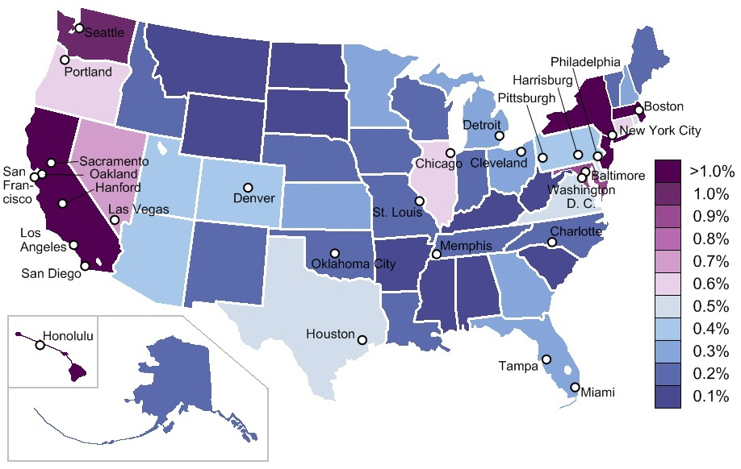

# Introduction
Arriving in the United States from China in 2019 gave me a close-up perspective on New York City’s Chinese American communities, which gradually grew into a focused research interest for this project. Growing up in Fujian, I was already familiar with local life there, and seeing many fellow Fujianese in New York City made the migration experience feel especially tangible. My father often pointed out that people come to the United States for very different reasons—some as skilled professionals, and others to earn a living while relying on exchange rate advantages and income differentials to support families back home. These contrasting pathways led me to examine how Chinese American communities are spatially organized across the United States, particularly given that the New York Metropolitan Area ranks first among analyzed metropolitan areas with 881,137 Chinese residents. At the national level, this project focuses on geographic distribution and population concentration, while in New York City it further examines residential density using PLUTO building data, treating occupational profiles and age distributions as supplementary questions that require additional data to explore. Investigating these spatial patterns offers a clearer empirical picture of the community and can help inform urban development and more effective integration within a diverse society.


{width="75%" fig-align="center"}

{width="90%" fig-align="center"}


# Task 0: Census API Key Setup

```{r}
#| label: setup
#| include: false

library(tidycensus)
library(tidyverse)
library(sf)

readRenviron("~/.Renviron")

stopifnot(
  nzchar(Sys.getenv("CENSUS_API_KEY"))
)
```

For Task 0, I requested and activated an API key from the U.S. Census Bureau and stored it locally in my .Renviron file for access via the CENSUS_API_KEY environment variable using `tidycensus`. For security reasons, the key itself is omitted from all published code.

# Task 1: CBSA Population Breakdown
```{r}

#| label: cbsa-population
#| message: false
#| warning: false

# Create the data directory
dir.create("data/mp03", recursive = TRUE, showWarnings = FALSE)

# Cache for 2024 ACS 5-Year data
cbsa_file <- "data/mp03/cbsa_chinese_2024_acs5.gpkg"

if (!file.exists(cbsa_file)) {

  CBSA_RAW <- tidycensus::get_acs(
    geography = "cbsa",
    variables = c(
      chinese = "B02018_002",
      total = "B01003_001"
    ),
    year = 2024,
    survey = "acs5",
    geometry = TRUE,
    output = "wide"
  )

  # Check that Chinese population data was retrieved
  stopifnot(sum(!is.na(CBSA_RAW$chineseE)) > 0)

  # Save a local copy
  sf::st_write(
    CBSA_RAW,
    cbsa_file,
    quiet = TRUE
  )
}

# Read the cached data
CBSA_RAW <- sf::st_read(cbsa_file, quiet = TRUE)

# Check cached estimates
stopifnot(sum(!is.na(CBSA_RAW$chineseE)) > 0)

# Prepare population measures
CBSA_POPULATION <- CBSA_RAW |>
  mutate(
    chinese_population = chineseE,
    total_population = totalE,
    chinese_share = if_else(
      total_population > 0,
      100 * chinese_population / total_population,
      NA_real_
    )
  )


```
For Task 1, I retrieve data from the U.S. Census Bureau using the `get_acs()` function in the `tidycensus` R package at the Core-Based Statistical Area (CBSA) geographic level. Specifically, I extract B02018_002 (Chinese, except Taiwanese) and B01003_001 (Total Population) to compute `chinese_share` as (Chinese Population / Total Population) × 100, keeping in mind that ACS figures are statistical estimates rather than exact decennial census counts. Although I initially tested the 2025 ACS 1-Year estimates, all 536 CBSAs returned NA for the Chinese population variable, so I switched to the 2024 ACS 5-Year estimates to obtain complete coverage. 


# Task 2: NYC Tract Population Breakdown
```{r}

#| label: nyc-tract-population
#| code-fold: true
#| message: false
#| warning: false

# Define the five NYC counties
nyc_counties <- c("005", "047", "061", "081", "085")

# Define the local cache file
nyc_tract_file <- "data/mp03/nyc_tract_chinese_2024_acs5.gpkg"

# Download only when the cache is missing
if (!file.exists(nyc_tract_file)) {

  NYC_TRACTS_RAW <- tidycensus::get_acs(
    geography = "tract",
    variables = c(
      chinese = "B02018_002",
      total = "B01003_001"
    ),
    state = "NY",
    county = nyc_counties,
    year = 2024,
    survey = "acs5",
    geometry = TRUE,
    output = "wide"
  )

  # Validate the downloaded data
  stopifnot(
    inherits(NYC_TRACTS_RAW, "sf"),
    nrow(NYC_TRACTS_RAW) > 0,
    sum(!is.na(NYC_TRACTS_RAW$chineseE)) > 0,
    all(substr(NYC_TRACTS_RAW$GEOID, 3, 5) %in% nyc_counties)
  )

  # Save population data and geographic boundaries
  sf::st_write(
    NYC_TRACTS_RAW,
    nyc_tract_file,
    quiet = TRUE
  )
}

# Read the locally cached data
NYC_TRACTS_RAW <- sf::st_read(
  nyc_tract_file,
  quiet = TRUE
)

# Prepare NYC tract population measures
NYC_TRACT_POPULATION <- NYC_TRACTS_RAW |>
  mutate(
    chinese_population = if_else(
      chineseE >= 0,
      as.numeric(chineseE),
      NA_real_
    ),
    total_population = if_else(
      totalE >= 0,
      as.numeric(totalE),
      NA_real_
    ),
    chinese_share = if_else(
      total_population > 0 & !is.na(chinese_population),
      100 * chinese_population / total_population,
      NA_real_
    )
  )

```
For Task 2, I retrieve data from the 2024 ACS 5-Year estimates using `get_acs()` across all Census Tracts within New York City's five boroughs. Consistent with Task 1, I extract B02018_002 (Chinese, except Taiwanese) and B01003_001 (Total Population), downloading spatial geometries with `geometry = TRUE` and caching the resulting dataset locally as a GeoPackage file. Validation confirms coverage across all five boroughs totaling 2,327 Census Tracts, with zero missing values in the Chinese population estimates.

# Task 3: NYC Neighborhood Tabulation Areas

```{r}

#| label: load-nyc-nta
#| code-fold: true
#| message: false
#| warning: false

load_nyc_nta <- function() {

  # 1. Create the data directory
  dir.create(
    "data/mp03",
    recursive = TRUE,
    showWarnings = FALSE
  )

  # 2. Define cache locations
  nta_zip <- "data/mp03/nyc_nta_2020.zip"
  nta_dir <- "data/mp03/nyc_nta_2020"

  # NYC Open Data: 2020 NTA shapefile export
  nta_url <- paste0(
    "https://data.cityofnewyork.us/api/geospatial/",
    "9nt8-h7nd?method=export&format=Shapefile"
  )

  # 3. Check for an existing shapefile
  shp_files <- list.files(
    nta_dir,
    pattern = "\\.shp$",
    recursive = TRUE,
    full.names = TRUE,
    ignore.case = TRUE
  )

  # 4. Download and unzip only if needed
  if (length(shp_files) == 0) {

    if (!file.exists(nta_zip)) {
      download.file(
        url = nta_url,
        destfile = nta_zip,
        mode = "wb",
        quiet = TRUE
      )
    }

    dir.create(
      nta_dir,
      recursive = TRUE,
      showWarnings = FALSE
    )

    unzip(nta_zip, exdir = nta_dir)

    shp_files <- list.files(
      nta_dir,
      pattern = "\\.shp$",
      recursive = TRUE,
      full.names = TRUE,
      ignore.case = TRUE
    )
  }

  stopifnot(length(shp_files) > 0)

  # 5. Read the shapefile
  nta <- sf::st_read(
    shp_files[1],
    quiet = TRUE
  )

  # Standardize column names
  names(nta) <- tolower(names(nta))

  stopifnot(
    all(c(
      "nta2020",
      "ntaname",
      "boroname"
    ) %in% names(nta))
  )

  # 6. Keep useful columns
  nta <- nta |>
    dplyr::select(
      nta2020,
      ntaname,
      boroname,
      dplyr::any_of("ntatype")
    )

  return(nta)
}

# Load NYC NTA data
NYC_NTA <- load_nyc_nta()

```
I retrieve the 2020 Neighborhood Tabulation Areas (NTAs) spatial boundary dataset from the NYC Department of City Planning — Neighborhood Tabulation Areas using download.file() and read the shapefile with `sf::st_read()`. Local caching is implemented to avoid repeated downloads, and validation confirms a total of 262 NTA spatial units.

# Task 4: Aggregate Tract Data to the NTA Level
```{r}

#| label: aggregate-tract-to-nta
#| code-fold: true
#| message: false
#| warning: false

# Use a common projected CRS for spatial matching
tracts_projected <- NYC_TRACT_POPULATION |>
  sf::st_transform(2263) |>
  dplyr::select(
    GEOID,
    chinese_population,
    total_population
  )

nta_projected <- NYC_NTA |>
  sf::st_transform(2263) |>
  dplyr::select(nta2020)

# Step 1: Assign each tract to its largest overlapping NTA
TRACT_NTA_JOINED <- sf::st_join(
  tracts_projected,
  nta_projected,
  largest = TRUE,
  left = TRUE
)

# Step 2: Check that no tracts were duplicated
stopifnot(
  nrow(TRACT_NTA_JOINED) == nrow(NYC_TRACT_POPULATION)
)

# Step 3: Aggregate population by NTA
NTA_SUMMARY <- TRACT_NTA_JOINED |>
  sf::st_drop_geometry() |>
  dplyr::filter(!is.na(nta2020)) |>
  dplyr::group_by(nta2020) |>
  dplyr::summarise(
    chinese_population = sum(chinese_population, na.rm = TRUE),
    total_population = sum(total_population, na.rm = TRUE),
    n_tracts = dplyr::n(),
    .groups = "drop"
  )

# Step 4: Reconnect population data to NTA geometries
NYC_NTA_POPULATION <- NYC_NTA |>
  dplyr::left_join(
    NTA_SUMMARY,
    by = "nta2020"
  ) |>
  dplyr::mutate(
    chinese_share = dplyr::if_else(
      !is.na(total_population) & total_population > 0,
      100 * chinese_population / total_population,
      NA_real_
    )
  )

```

I assign each Census Tract to a Neighborhood Tabulation Area (NTA) by maximum overlap area using `sf::st_join()` with `largest = TRUE`. I then aggregate Chinese and total populations by NTA and join the results to the NTA boundaries. Out of 2,327 tracts, I find 3 remain unmatched, but all three have zero population, causing no loss of Chinese population estimates. Across 262 NTAs, I match 261 to population records, leaving Hoffman & Swinburne Islands as the sole unmatched area. Because I rely on spatial-overlap aggregation, I treat these figures as an approximation rather than exact NTA population counts.

# Task 5: Download PLUTO

```{r}

#| label: load-nyc-pluto
#| code-fold: true
#| message: false
#| warning: false

load_nyc_pluto <- function() {

  # Create local cache directory
  dir.create(
    "data/mp03",
    recursive = TRUE,
    showWarnings = FALSE
  )

  pluto_file <- "data/mp03/pluto.csv"

  pluto_url <- paste0(
    "https://data.cityofnewyork.us/",
    "resource/64uk-42ks.csv"
  )

  # Keep variables needed for subsequent analyses
  pluto_columns <- c(
    "bbl",
    "bct2020",
    "officearea",
    "unitsres",
    "resarea",
    "numfloors",
    "comarea",
    "bldgarea",
    "landuse",
    "unitstotal"
  )

  # Preserve geographic identifiers as character values
  pluto_types <- readr::cols(
    .default = readr::col_double(),
    bbl = readr::col_character(),
    bct2020 = readr::col_character(),
    landuse = readr::col_character()
  )

  # Return cached data if available
  if (file.exists(pluto_file)) {
    return(
      readr::read_csv(
        pluto_file,
        col_types = pluto_types,
        show_col_types = FALSE
      )
    )
  }

  # Obtain the total number of API records
  count_response <- httr2::request(pluto_url) |>
    httr2::req_url_query(
      `$select` = "count(*) as total_rows"
    ) |>
    httr2::req_retry(max_tries = 4) |>
    httr2::req_perform()

  expected_rows <- readr::read_csv(
    I(httr2::resp_body_string(count_response)),
    show_col_types = FALSE
  )$total_rows[[1]]

  stopifnot(expected_rows > 0)

  # Initialize pagination
  page_size <- 20000
  offset <- 0
  pages <- list()

  # Download all pages sequentially
  while (offset < expected_rows) {

    response <- httr2::request(pluto_url) |>
      httr2::req_url_query(
        `$select` = paste(pluto_columns, collapse = ","),
        `$limit` = page_size,
        `$offset` = offset,
        `$order` = ":id"
      ) |>
      httr2::req_timeout(120) |>
      httr2::req_retry(max_tries = 4) |>
      httr2::req_perform()

    page <- readr::read_csv(
      I(httr2::resp_body_string(response)),
      col_types = pluto_types,
      show_col_types = FALSE
    )

    # Validate the returned page
    stopifnot(
      all(pluto_columns %in% names(page)),
      nrow(page) == min(
        page_size,
        expected_rows - offset
      )
    )

    pages[[length(pages) + 1]] <- page

    offset <- offset + nrow(page)

    message(
      "Downloaded ",
      offset,
      " of ",
      expected_rows,
      " records"
    )

    Sys.sleep(0.5)
  }

  # Combine all API responses
  pluto <- dplyr::bind_rows(pages)

  # Validate completeness
  stopifnot(
    nrow(pluto) == expected_rows
  )

  # Save the complete dataset locally
  readr::write_csv(pluto, pluto_file)

  return(pluto)
}

# Load NYC PLUTO data
NYC_PLUTO <- load_nyc_pluto()

```
I retrieve parcel records from NYC Department of City Planning — PLUTO using httr2 with paginated API requests ($limit and $offset at 20,000 rows per page), request pacing, automatic retries, and `bind_rows()` to combine pages. I cache the output locally via `write_csv()` to avoid repeated downloads. Validation confirms `r format(nrow(NYC_PLUTO), big.mark = ",")` tax lot records across 10 variables with no duplicate BBL values.

```{r}
#| label: prepare-pluto-geoid
#| code-fold: true

NYC_PLUTO <- NYC_PLUTO |>
  mutate(
    bbl = str_remove(bbl, "\\.0+$"),

    borough_code = substr(bct2020, 1, 1),

    county_fips = case_when(
      borough_code == "1" ~ "061",
      borough_code == "2" ~ "005",
      borough_code == "3" ~ "047",
      borough_code == "4" ~ "081",
      borough_code == "5" ~ "085",
      TRUE ~ NA_character_
    ),

    GEOID = if_else(
      !is.na(county_fips) &
        str_detect(bct2020, "^[1-5][0-9]{6}$"),
      paste0("36", county_fips, substr(bct2020, 2, 7)),
      NA_character_
    )
  )
```

I clean trailing decimal suffixes from bbl and convert PLUTO's seven-digit bct2020 code into an eleven-digit ACS GEOID by mapping the borough code to its Census county FIPS code and prepending New York State's FIPS code (36). Unconvertible codes remain NA to prevent erroneous matches.

```{r}
#| label: link-pluto-to-nta
#| code-fold: true

TRACT_NTA_LOOKUP <- TRACT_NTA_JOINED |>
  sf::st_drop_geometry() |>
  select(GEOID, nta2020)

NYC_PLUTO_NTA <- NYC_PLUTO |>
  left_join(
    TRACT_NTA_LOOKUP,
    by = "GEOID",
    relationship = "many-to-one"
  )

stopifnot(
  nrow(NYC_PLUTO_NTA) == nrow(NYC_PLUTO)
)
```

I link PLUTO tax lots to Neighborhood Tabulation Areas using the tract-to-NTA crosswalk established in Task 4 via `left_join()` on the standardized GEOID with relationship = "many-to-one". This allows multiple parcels per tract without duplicating records, confirmed by matching row counts before and after the join, and prepares the dataset for residential area, residential unit, and office area analysis.

# Task 6: Exploratory Data Analysis

## Question 1: Which NYC Census Tract has the Most Office Floor Area?

```{r}

#| label: eda-q1-office-area
#| code-fold: true
#| message: false
#| warning: false

# Aggregate office floor area by Census Tract
OFFICE_BY_TRACT <- NYC_PLUTO |>
  filter(!is.na(GEOID)) |>
  group_by(GEOID) |>
  summarise(
    total_office_sqft = sum(officearea, na.rm = TRUE),
    tax_lots = n(),
    .groups = "drop"
  ) |>
  left_join(
    NYC_TRACT_POPULATION |>
      sf::st_drop_geometry() |>
      select(GEOID, NAME),
    by = "GEOID"
  ) |>
  filter(!is.na(NAME)) |>
  arrange(desc(total_office_sqft))

# Identify the top 5 tracts
OFFICE_TRACT_TOP5 <- OFFICE_BY_TRACT |>
  slice_head(n = 5)

# Create a publication-quality table
OFFICE_TRACT_TOP5 |>
  select(NAME, GEOID, total_office_sqft, tax_lots) |>
  gt::gt() |>
  gt::tab_header(
    title = "Top 5 NYC Census Tracts by Office Floor Area",
    subtitle = "NYC PLUTO Data"
  ) |>
  gt::cols_label(
    NAME = "Census Tract",
    GEOID = "GEOID",
    total_office_sqft = "Office Area (sq. ft.)",
    tax_lots = "Tax Lots"
  ) |>
  gt::fmt_number(
    columns = c(total_office_sqft, tax_lots),
    decimals = 0
  )

```
**Answer**: Ranked by PLUTO data, `r OFFICE_TRACT_TOP5$NAME[[1]]` has the most office floor area in New York City, with `r format(OFFICE_TRACT_TOP5$total_office_sqft[[1]], big.mark = ",", scientific = FALSE)` sq.ft. across `r OFFICE_TRACT_TOP5$tax_lots[[1]]` Tax Lots.

## Question 2: Which NYC NTA Has the Most Residential Units?
```{r}

#| label: eda-q2-residential-units
#| code-fold: true
#| message: false
#| warning: false

# Aggregate residential units by NTA
NTA_RESIDENTIAL_UNITS <- NYC_PLUTO_NTA |>
  filter(!is.na(nta2020)) |>
  group_by(nta2020) |>
  summarise(
    residential_units = sum(unitsres, na.rm = TRUE),
    tax_lots = n(),
    .groups = "drop"
  ) |>
  left_join(
    NYC_NTA |>
      sf::st_drop_geometry() |>
      select(nta2020, ntaname, boroname),
    by = "nta2020"
  ) |>
  arrange(desc(residential_units))

# Identify the top 5 NTAs
NTA_UNITS_TOP5 <- NTA_RESIDENTIAL_UNITS |>
  slice_head(n = 5)

# Create a formatted table
NTA_UNITS_TOP5 |>
  select(ntaname, boroname, residential_units, tax_lots) |>
  gt::gt() |>
  gt::tab_header(
    title = "Top 5 NYC Neighborhoods by Residential Units",
    subtitle = "NYC PLUTO Data"
  ) |>
  gt::cols_label(
    ntaname = "Neighborhood",
    boroname = "Borough",
    residential_units = "Residential Units",
    tax_lots = "Tax Lots"
  ) |>
  gt::fmt_number(
    columns = c(residential_units, tax_lots),
    decimals = 0
  )

```
**Answer**: According to NYC PLUTO data, **`r NTA_UNITS_TOP5$ntaname[[1]]`** in **`r NTA_UNITS_TOP5$boroname[[1]]`** has the most residential units among NYC NTAs, with **`r format(NTA_UNITS_TOP5$residential_units[[1]], big.mark = ",", scientific = FALSE)`** residential units across **`r format(NTA_UNITS_TOP5$tax_lots[[1]], big.mark = ",", scientific = FALSE)`** Tax Lots.

## Question 3: Population Density and Residential Space

### 3.1 Calculating Residential Density Measures
```{r}

#| label: eda-q3-density
#| code-fold: true
#| message: false
#| warning: false

# Step 1: Aggregate residential space and units by tract
PLUTO_TRACT_HOUSING <- NYC_PLUTO |>
  filter(!is.na(GEOID)) |>
  group_by(GEOID) |>
  summarise(
    residential_sqft = if (all(is.na(resarea))) {
      NA_real_
    } else {
      sum(resarea, na.rm = TRUE)
    },

    residential_units = if (all(is.na(unitsres))) {
      NA_real_
    } else {
      sum(unitsres, na.rm = TRUE)
    },

    missing_resarea_lots = sum(is.na(resarea)),
    missing_units_lots = sum(is.na(unitsres)),
    .groups = "drop"
  )

# Step 2: Join ACS population with PLUTO housing data
TRACT_DENSITY <- NYC_TRACT_POPULATION |>
  sf::st_drop_geometry() |>
  select(GEOID, NAME, total_population) |>
  left_join(
    PLUTO_TRACT_HOUSING,
    by = "GEOID",
    relationship = "one-to-one"
  ) |>
  mutate(
    people_per_sqft = if_else(
      total_population > 0 &
        !is.na(residential_sqft) &
        residential_sqft > 0,
      total_population / residential_sqft,
      NA_real_
    ),

    people_per_unit = if_else(
      total_population > 0 &
        !is.na(residential_units) &
        residential_units > 0,
      total_population / residential_units,
      NA_real_
    )
  )

# Step 3: Top 5 by population per residential square foot
Q3_AREA_TOP5 <- TRACT_DENSITY |>
  filter(is.finite(people_per_sqft)) |>
  arrange(desc(people_per_sqft)) |>
  slice_head(n = 5)

# Step 4: Top 5 by population per residential unit
Q3_UNIT_TOP5 <- TRACT_DENSITY |>
  filter(is.finite(people_per_unit)) |>
  arrange(desc(people_per_unit)) |>
  slice_head(n = 5)

```

### 3.2 Comparing Population Density Rankings
```{r}

#| label: eda-q3-rankings
#| code-fold: true
#| message: false
#| warning: false

# Top 5: Population per Residential Square Foot
Q3_AREA_TOP5 |>
  select(
    NAME,
    total_population,
    residential_sqft,
    people_per_sqft,
    missing_resarea_lots
  ) |>
  gt::gt() |>
  gt::tab_header(
    title = "Top 5 NYC Census Tracts by Population per Residential Square Foot"
  ) |>
  gt::cols_label(
    NAME = "Census Tract",
    total_population = "Population",
    residential_sqft = "Residential Area (sq. ft.)",
    people_per_sqft = "People per Sq. Ft.",
    missing_resarea_lots = "Lots Missing Area"
  ) |>
  gt::fmt_number(
    columns = c(total_population, residential_sqft),
    decimals = 0
  ) |>
  gt::fmt_number(
    columns = people_per_sqft,
    decimals = 5
  )

# Top 5: Population per Residential Unit
Q3_UNIT_TOP5 |>
  select(
    NAME,
    total_population,
    residential_units,
    people_per_unit,
    missing_units_lots
  ) |>
  gt::gt() |>
  gt::tab_header(
    title = "Top 5 NYC Census Tracts by Population per Residential Unit"
  ) |>
  gt::cols_label(
    NAME = "Census Tract",
    total_population = "Population",
    residential_units = "Residential Units",
    people_per_unit = "People per Unit",
    missing_units_lots = "Lots Missing Units"
  ) |>
  gt::fmt_number(
    columns = c(total_population, residential_units),
    decimals = 0
  ) |>
  gt::fmt_number(
    columns = people_per_unit,
    decimals = 2
  )

```

**Answer**: `r Q3_AREA_TOP5$NAME[[1]]` has the highest population density under both measures, with `r sprintf("%.5f", Q3_AREA_TOP5$people_per_sqft[[1]])` people per residential square foot and `r sprintf("%.2f", Q3_UNIT_TOP5$people_per_unit[[1]])` people per residential unit. Switching to population per residential unit does not change the top-ranked tract, though the rest of the top five shifts. For example, `r Q3_AREA_TOP5$NAME[[2]]` stays second, while `r Q3_UNIT_TOP5$NAME[[3]]` moves up into third. These extreme figures are also shaped by very small residential area or unit denominators and lots missing data in the tables.


### Sensitivity Analysis
```{r}

#| label: q3-group-quarters-sensitivity
#| code-fold: true
#| message: false
#| warning: false

# Cache NYC group quarters population
gq_file <- "data/mp03/nyc_group_quarters_2024_acs5.rds"

if (!file.exists(gq_file)) {

  GQ_NYC <- tidycensus::get_acs(
    geography = "tract",
    variables = c(
      group_quarters = "B26001_001"
    ),
    state = "NY",
    county = nyc_counties,
    year = 2024,
    survey = "acs5",
    geometry = FALSE,
    output = "wide"
  )

  saveRDS(GQ_NYC, gq_file)
}

GQ_NYC <- readRDS(gq_file)

# Calculate housing-based density excluding group quarters
Q3_SENSITIVITY <- TRACT_DENSITY |>
  left_join(
    GQ_NYC |>
      select(GEOID, group_quartersE),
    by = "GEOID"
  ) |>
  mutate(
    household_population = pmax(
      total_population - group_quartersE,
      0
    ),

    household_per_sqft = if_else(
      residential_sqft > 0,
      household_population / residential_sqft,
      NA_real_
    ),

    household_per_unit = if_else(
      residential_units > 0,
      household_population / residential_units,
      NA_real_
    )
  )


# Store the highest-ranked tract after excluding group quarters

Q3_SENS_AREA_TOP1 <- Q3_SENSITIVITY |>
  filter(
    is.finite(household_per_sqft),
    household_population > 0
  ) |>
  arrange(desc(household_per_sqft)) |>
  slice_head(n = 1)

Q3_SENS_UNIT_TOP1 <- Q3_SENSITIVITY |>
  filter(
    is.finite(household_per_unit),
    household_population > 0
  ) |>
  arrange(desc(household_per_unit)) |>
  slice_head(n = 1)


```

**Analysis & Findings**: Initial density rankings can be misleading because the 2024 ACS 5-Year estimates indicate that all `r format(Q3_AREA_TOP5$total_population[[1]], big.mark = ",", scientific = FALSE)` residents in the original top tract, `r Q3_AREA_TOP5$NAME[[1]]` belong to the group quarters population rather than standard housing. To address this, I subtract the estimated group quarters population from the ACS total population estimate and recalculate both residential density measures.

After this adjustment, `r Q3_SENS_AREA_TOP1$NAME[[1]]` ranks first on both metrics. Subtracting ACS estimates still leaves an estimated `r Q3_SENS_AREA_TOP1$household_population[[1]]` non-group-quarters residents against only `r Q3_SENS_UNIT_TOP1$residential_units[[1]]` PLUTO residential unit. This does not confirm that those residents actually occupy that single unit, highlighting how definition differences between ACS and PLUTO persist.

## Question 4: Top Five Metropolitan Areas by Chinese Population Share

### 4.1 Ranking Metropolitan Areas by Chinese Population Share
```{r}

#| label: eda-q4-chinese-share
#| code-fold: true
#| message: false
#| warning: false

# Exclude the New York Metropolitan Area
nyc_cbsa_id <- "35620"

# Rank metropolitan areas by Chinese population share
Q4_METRO_TOP5 <- CBSA_POPULATION |>
  sf::st_drop_geometry() |>
  as_tibble() |>
  filter(
    str_detect(NAME, "Metro Area$"),
    GEOID != nyc_cbsa_id,
    !is.na(chinese_population),
    chinese_population >= 0,
    !is.na(total_population),
    total_population > 0
  ) |>
  arrange(
    desc(chinese_share),
    desc(chinese_population)
  ) |>
  slice_head(n = 5) |>
  mutate(rank = row_number())

# Validate the results
stopifnot(
  nrow(Q4_METRO_TOP5) == 5,
  all(Q4_METRO_TOP5$GEOID != nyc_cbsa_id)
)

# Create a formatted table
Q4_METRO_TOP5 |>
  select(
    rank,
    NAME,
    chinese_population,
    total_population,
    chinese_share
  ) |>
  gt::gt() |>
  gt::tab_header(
    title = "Top 5 U.S. Metropolitan Areas by Chinese Population Share",
    subtitle = "Excluding New York | 2024 ACS 5-Year"
  ) |>
  gt::cols_label(
    rank = "Rank",
    NAME = "Metropolitan Area",
    chinese_population = "Chinese Population",
    total_population = "Total Population",
    chinese_share = "Chinese Share (%)"
  ) |>
  gt::fmt_number(
    columns = c(chinese_population, total_population),
    decimals = 0
  ) |>
  gt::fmt_number(
    columns = chinese_share,
    decimals = 2
  )

```

### 4.2 Visualization: Chinese Population Concentration
```{r}

#| label: eda-q4-bar-chart
#| code-fold: true
#| fig-width: 10
#| fig-height: 5.5
#| fig-cap: "Chinese population share across the top five non-NYC metropolitan areas, 2024 ACS 5-Year."
#| message: false
#| warning: false

Q4_METRO_TOP5 |>
  mutate(
    metro_label = str_remove(NAME, " Metro Area$"),
    metro_label = str_wrap(metro_label, width = 32),
    highlight = if_else(
      rank == 1, "Highest Share", "Other Metro Areas"
    )
  ) |>
  ggplot(
    aes(
      x = chinese_share,
      y = forcats::fct_reorder(metro_label, chinese_share),
      fill = highlight
    )
  ) +
  geom_col(width = 0.65) +
  geom_text(
    aes(label = sprintf("%.2f%%", chinese_share)),
    hjust = -0.15,
    color = "#204A73",
    size = 4
  ) +
  scale_fill_manual(
    values = c(
      "Highest Share" = "#B52B3A",
      "Other Metro Areas" = "#204A73"
    ),
    guide = "none"
  ) +
  scale_x_continuous(
    limits = c(0, 20),
    labels = function(x) paste0(x, "%")
  ) +
  labs(
    title = "Chinese American Population Concentration",
    subtitle = "Top Five U.S. Metro Areas Excluding New York",
    x = "Chinese Share of Total Population",
    y = NULL,
    caption = "Source: U.S. Census Bureau, 2024 ACS 5-Year"
  ) +
  theme_minimal(base_size = 12) +
  theme(
    plot.title = element_text(
      face = "bold",
      color = "#204A73"
    ),
    panel.grid.major.y = element_blank(),
    panel.grid.minor = element_blank()
  )

```
**Analysis & Findings**: Excluding New York, Urban Honolulu has the highest Chinese population share among analyzed metropolitan areas at `r sprintf("%.2f%%", Q4_METRO_TOP5$chinese_share[[1]])`, followed by San Jose (`r sprintf("%.2f%%", Q4_METRO_TOP5$chinese_share[[2]])`) and San Francisco (`r sprintf("%.2f%%", Q4_METRO_TOP5$chinese_share[[3]])`). All top five metropolitan areas are located in Hawaii (two) and California (three), pointing to strong regional concentration. Looking at population share alongside raw counts highlights a clear contrast: Los Angeles has far more Chinese residents (`r format(Q4_METRO_TOP5$chinese_population[[5]], big.mark = ",", scientific = FALSE)`) than Urban Honolulu (`r format(Q4_METRO_TOP5$chinese_population[[1]], big.mark = ",", scientific = FALSE)`), but they make up a much smaller share of the local population (`r sprintf("%.2f%%", Q4_METRO_TOP5$chinese_share[[5]])` vs. `r sprintf("%.2f%%", Q4_METRO_TOP5$chinese_share[[1]])`). Having a large overall headcount does not mean a group is heavily concentrated locally.

## Question 5: Ancestry Distribution in Urban Honolulu

{#fig-waikiki width="75%" fig-align="center"}

### 5.1 Acquiring Urban Honolulu Demographic Data
```{r}

#| label: eda-q5-honolulu-data
#| code-fold: true
#| message: false
#| warning: false

# Cache Honolulu city-level demographic data
q5_file <- "data/mp03/urban_honolulu_ancestry_2024_acs5.csv"

if (!file.exists(q5_file)) {

  HONOLULU_RAW <- tidycensus::get_acs(
    geography = "place",
    state = "HI",
    year = 2024,
    survey = "acs5",
    output = "wide",
    variables = c(
      total = "B02001_001",
      white = "B02001_002",
      black = "B02001_003",
      american_indian = "B02001_004",
      asian = "B02001_005",
      pacific_islander = "B02001_006",
      other_race = "B02001_007",
      multiracial = "B02001_008",
      chinese = "B02018_002",
      japanese = "B02018_004",
      korean = "B02018_005",
      taiwanese = "B02018_008",
      filipino = "B02018_012",
      vietnamese = "B02018_019"
    )
  )

  # Urban Honolulu CDP GEOID
  HONOLULU_DATA <- HONOLULU_RAW |>
    filter(GEOID == "1571550")

  stopifnot(
    nrow(HONOLULU_DATA) == 1,
    !is.na(HONOLULU_DATA$totalE[[1]])
  )

  readr::write_csv(HONOLULU_DATA, q5_file)
}

# Read the cached data
HONOLULU_DATA <- readr::read_csv(
  q5_file,
  col_types = readr::cols(
    GEOID = readr::col_character(),
    .default = readr::col_guess()
  ),
  show_col_types = FALSE
)

stopifnot(
  nrow(HONOLULU_DATA) == 1,
  HONOLULU_DATA$GEOID[[1]] == "1571550"
)

```

### 5.2 Selected Asian Population Groups
```{r}

#| label: eda-q5-asian-ancestry
#| code-fold: true
#| message: false
#| warning: false

# Selected Asian population groups
Q5_ASIAN_GROUPS <- tibble(
  ancestry = c(
    "Chinese (except Taiwanese)",
    "Filipino",
    "Japanese",
    "Korean",
    "Vietnamese",
    "Taiwanese"
  ),
  population = c(
    HONOLULU_DATA$chineseE[[1]],
    HONOLULU_DATA$filipinoE[[1]],
    HONOLULU_DATA$japaneseE[[1]],
    HONOLULU_DATA$koreanE[[1]],
    HONOLULU_DATA$vietnameseE[[1]],
    HONOLULU_DATA$taiwaneseE[[1]]
  )
) |>
  filter(!is.na(population)) |>
  mutate(
    share_city = 100 * population /
      HONOLULU_DATA$totalE[[1]]
  ) |>
  arrange(desc(population))

# Display the ancestry comparison
Q5_ASIAN_GROUPS |>
  gt::gt() |>
  gt::tab_header(
    title = "Selected Asian Population Groups in Urban Honolulu",
    subtitle = "2024 ACS 5-Year Estimates"
  ) |>
  gt::cols_label(
    ancestry = "Population Group",
    population = "Estimated Population",
    share_city = "Share of City Population (%)"
  ) |>
  gt::fmt_number(
    columns = population,
    decimals = 0
  ) |>
  gt::fmt_number(
    columns = share_city,
    decimals = 2
  )

```

### 5.3 Visualization: Racial Composition of Urban Honolulu
```{r}

#| label: eda-q5-race-composition
#| code-fold: true
#| fig-width: 9
#| fig-height: 5
#| message: false
#| warning: false

Q5_RACE <- tibble(
  race = c(
    "White alone",
    "Black alone",
    "American Indian / Alaska Native alone",
    "Asian alone",
    "Native Hawaiian / Pacific Islander alone",
    "Some Other Race alone",
    "Two or More Races"
  ),
  population = c(
    HONOLULU_DATA$whiteE[[1]],
    HONOLULU_DATA$blackE[[1]],
    HONOLULU_DATA$american_indianE[[1]],
    HONOLULU_DATA$asianE[[1]],
    HONOLULU_DATA$pacific_islanderE[[1]],
    HONOLULU_DATA$other_raceE[[1]],
    HONOLULU_DATA$multiracialE[[1]]
  )
) |>
  mutate(
    share = 100 * population / HONOLULU_DATA$totalE[[1]],
    highlight = if_else(race == "Asian alone", "Asian", "Other")
  )

ggplot(
  Q5_RACE,
  aes(
    x = share,
    y = forcats::fct_reorder(race, share),
    fill = highlight
  )
) +
  geom_col(width = 0.65) +
  scale_fill_manual(
    values = c(
      "Asian" = "#B52B3A",
      "Other" = "#204A73"
    ),
    guide = "none"
  ) +
  scale_x_continuous(
    labels = function(x) paste0(x, "%")
  ) +
  labs(
    title = "Racial Composition of Urban Honolulu",
    subtitle = "2024 ACS 5-Year Estimates",
    x = "Share of City Population",
    y = NULL,
    caption = "Source: U.S. Census Bureau, Table B02001"
  ) +
  theme_minimal(base_size = 12) +
  theme(
    plot.title = element_text(
      face = "bold",
      color = "#204A73"
    ),
    panel.grid.major.y = element_blank()
  )

```
**Analysis & Findings:** In Urban Honolulu, Asian alone is the largest single racial group by a wide margin, ahead of Two or More Races and White alone. Among major Asian groups in the table, Japanese residents lead with `r format(Q5_ASIAN_GROUPS$population[Q5_ASIAN_GROUPS$ancestry == "Japanese"], big.mark = ",")`
 (`r sprintf("%.2f%%", Q5_ASIAN_GROUPS$share_city[Q5_ASIAN_GROUPS$ancestry == "Japanese"])`), followed closely by Chinese (except Taiwanese) at `r format(Q5_ASIAN_GROUPS$population[Q5_ASIAN_GROUPS$ancestry == "Chinese (except Taiwanese)"], big.mark = ",")` (`r sprintf("%.2f%%", Q5_ASIAN_GROUPS$share_city[Q5_ASIAN_GROUPS$ancestry == "Chinese (except Taiwanese)"])`) and Filipino at `r format(Q5_ASIAN_GROUPS$population[Q5_ASIAN_GROUPS$ancestry == "Filipino"], big.mark = ",")` (`r sprintf("%.2f%%", Q5_ASIAN_GROUPS$share_city[Q5_ASIAN_GROUPS$ancestry == "Filipino"])`). 
Moving from the metro level in Q4 to the Urban Honolulu CDP in Q5, the Chinese share goes up from `r sprintf("%.2f%%", Q4_METRO_TOP5$chinese_share[[1]])` to `r sprintf("%.2f%%", Q5_ASIAN_GROUPS$share_city[Q5_ASIAN_GROUPS$ancestry == "Chinese (except Taiwanese)"])`, which shows how changing geographic boundaries changes what you see. Also, detailed Asian group categories can overlap, so the numbers don't split people into separate, non-overlapping buckets.

## Question 6: Chinese American Population Distribution Across the United States

### 6.1: National and New York State Population Estimates
```{r}

#| label: eda-q6-national-population
#| code-fold: true
#| message: false
#| warning: false

# Cache nationwide and NY State ACS estimates
q6_file <- "data/mp03/us_ny_chinese_2024_acs5.csv"

q6_variables <- c(
  chinese = "B02018_002",
  total = "B01003_001"
)

if (!file.exists(q6_file)) {

  # United States
  US_RAW <- tidycensus::get_acs(
    geography = "us",
    variables = q6_variables,
    year = 2024,
    survey = "acs5",
    output = "wide"
  ) |>
    mutate(scope = "United States")

  # New York State
  NY_RAW <- tidycensus::get_acs(
    geography = "state",
    state = "NY",
    variables = q6_variables,
    year = 2024,
    survey = "acs5",
    output = "wide"
  ) |>
    mutate(scope = "New York State")

  Q6_US_NY <- dplyr::bind_rows(
    US_RAW,
    NY_RAW
  )

  readr::write_csv(Q6_US_NY, q6_file)
}

# Read locally cached ACS estimates
Q6_US_NY <- readr::read_csv(
  q6_file,
  col_types = readr::cols(
    GEOID = readr::col_character(),
    .default = readr::col_guess()
  ),
  show_col_types = FALSE
)

# Validate national and state estimates
stopifnot(
  nrow(Q6_US_NY) == 2,
  all(!is.na(Q6_US_NY$chineseE)),
  all(Q6_US_NY$chineseE > 0)
)

# Nationwide Chinese population denominator
US_CHINESE_TOTAL <- Q6_US_NY |>
  filter(scope == "United States") |>
  pull(chineseE)

# New York State share of nationwide Chinese population
Q6_NY_STATE <- Q6_US_NY |>
  filter(scope == "New York State") |>
  mutate(
    share_of_us = 100 * chineseE / US_CHINESE_TOTAL
  )

# Display the nationwide and NY State estimates
Q6_US_NY |>
  mutate(
    share_of_us = 100 * chineseE / US_CHINESE_TOTAL
  ) |>
  select(scope, chineseE, share_of_us) |>
  gt::gt() |>
  gt::tab_header(
    title = "Chinese Population: United States vs. New York State",
    subtitle = "2024 ACS 5-Year Estimates"
  ) |>
  gt::cols_label(
    scope = "Geographic Area",
    chineseE = "Chinese Population",
    share_of_us = "Share of U.S. Chinese Population (%)"
  ) |>
  gt::fmt_number(
    columns = chineseE,
    decimals = 0
  ) |>
  gt::fmt_number(
    columns = share_of_us,
    decimals = 2
  )

```

### 6.2 Chinese Population Across Major Metropolitan Areas
```{r}

#| label: eda-q6-metro-comparison
#| code-fold: true
#| message: false
#| warning: false

# Prepare large metropolitan areas
Q6_MAJOR_METROS <- CBSA_POPULATION |>
  sf::st_drop_geometry() |>
  as_tibble() |>
  filter(
    str_detect(NAME, "Metro Area$"),
    !is.na(chinese_population),
    !is.na(total_population),
    total_population >= 1000000
  ) |>
  mutate(
    share_of_us = 100 * chinese_population /
      US_CHINESE_TOTAL
  )

# New York Metropolitan Area
Q6_NYC_METRO <- Q6_MAJOR_METROS |>
  filter(GEOID == "35620")

# Eight other major metros with largest Chinese populations
Q6_OTHER_METROS <- Q6_MAJOR_METROS |>
  filter(GEOID != "35620") |>
  arrange(desc(chinese_population)) |>
  slice_head(n = 8)

# Combine for comparison
Q6_METRO_COMPARISON <- bind_rows(
  Q6_NYC_METRO,
  Q6_OTHER_METROS
) |>
  arrange(desc(chinese_population))

# Validate
stopifnot(
  nrow(Q6_NYC_METRO) == 1,
  nrow(Q6_OTHER_METROS) == 8,
  all(Q6_METRO_COMPARISON$share_of_us <= 100)
)

# Publication-quality table
Q6_METRO_COMPARISON |>
  select(
    NAME,
    chinese_population,
    share_of_us
  ) |>
  gt::gt() |>
  gt::tab_header(
    title = "Distribution of Chinese Americans Across Major U.S. Metros",
    subtitle = "Share of Nationwide Chinese Population | 2024 ACS 5-Year"
  ) |>
  gt::cols_label(
    NAME = "Metropolitan Area",
    chinese_population = "Chinese Population",
    share_of_us = "Share of U.S. Chinese Population (%)"
  ) |>
  gt::fmt_number(
    columns = chinese_population,
    decimals = 0
  ) |>
  gt::fmt_number(
    columns = share_of_us,
    decimals = 2
  )

```

### 6.3 Visualization: Chinese Population Distribution Across Major Metros
```{r}

#| label: eda-q6-metro-chart
#| code-fold: true
#| fig-width: 11
#| fig-height: 6
#| fig-cap: "Share of the nationwide Chinese (except Taiwanese) population in selected major metropolitan areas, 2024 ACS 5-Year."
#| message: false
#| warning: false

Q6_METRO_COMPARISON |>
  mutate(
    metro_label = str_remove(NAME, " Metro Area$"),
    metro_label = str_wrap(metro_label, width = 32),
    highlight = if_else(
      GEOID == "35620",
      "New York Metro",
      "Other Major Metros"
    )
  ) |>
  ggplot(
    aes(
      x = share_of_us,
      y = forcats::fct_reorder(metro_label, share_of_us),
      fill = highlight
    )
  ) +
  geom_col(width = 0.7) +
  geom_text(
    aes(label = sprintf("%.2f%%", share_of_us)),
    hjust = -0.15,
    color = "#204A73",
    size = 3.5
  ) +
  scale_fill_manual(
    values = c(
      "New York Metro" = "#B52B3A",
      "Other Major Metros" = "#204A73"
    ),
    name = NULL
  ) +
  scale_x_continuous(
    labels = function(x) paste0(x, "%"),
    expand = expansion(mult = c(0, 0.20))
  ) +
  labs(
    title = "Where Do Chinese Americans Live?",
    subtitle = "Share of Nationwide Chinese Population by Metropolitan Area",
    x = "Percentage of U.S. Chinese Population",
    y = NULL,
    caption = "Source: U.S. Census Bureau, 2024 ACS 5-Year Estimates"
  ) +
  theme_minimal(base_size = 12) +
  theme(
    plot.title = element_text(
      face = "bold",
      color = "#204A73"
    ),
    panel.grid.major.y = element_blank(),
    panel.grid.minor = element_blank(),
    legend.position = "bottom"
  )

```
**Analysis & Findings：** Out of an estimated `r format(US_CHINESE_TOTAL, big.mark = ",", scientific = FALSE)` Chinese residents nationwide, New York State accounts for `r sprintf("%.2f%%", Q6_NY_STATE$share_of_us[[1]])`  (`r format(Q6_NY_STATE$chineseE[[1]], big.mark = ",", scientific = FALSE)` residents), while the New York metro area accounts for `r sprintf("%.2f%%", Q6_NYC_METRO$share_of_us[[1]])` (`r format(Q6_NYC_METRO$chinese_population[[1]], big.mark = ",", scientific = FALSE)` residents). Examining the New York metropolitan area alongside eight other major metro areas with the largest Chinese populations—rather than every metro area in the country—New York (`r sprintf("%.2f%%", Q6_NYC_METRO$share_of_us[[1]])`), Los Angeles (`r sprintf("%.2f%%", Q6_OTHER_METROS$share_of_us[[1]])`), and San Francisco (`r sprintf("%.2f%%", Q6_OTHER_METROS$share_of_us[[2]])`) account for the largest share of the national population. Comparing Honolulu in Question 4 and Question 6 shows the distinction between local population concentration and the geographic distribution of the nationwide population: Honolulu ranks first in Question 4 because Chinese residents represent `r sprintf("%.2f%%", Q4_METRO_TOP5$chinese_share[[1]])`
 of the local metro population, yet it holds only 
`r sprintf("%.2f%%", Q6_METRO_COMPARISON$share_of_us[grepl("Urban Honolulu", Q6_METRO_COMPARISON$NAME)])` of the nationwide Chinese population in Question 6. Whereas local share reflects how concentrated a group is within a given area, national share captures where larger population totals reside across the country.

## Question 7: Population and Housing Relationships Across NYC Tracts

### 7.1 Preparing Population and Housing Data
```{r}

#| label: eda-q7-prepare-data
#| code-fold: true
#| message: false
#| warning: false

# Reshape existing tract-level data for comparison
Q7_HOUSING_LONG <- TRACT_DENSITY |>
  dplyr::select(
    GEOID,
    NAME,
    total_population,
    residential_units,
    residential_sqft
  ) |>
  tidyr::pivot_longer(
    cols = c(residential_units, residential_sqft),
    names_to = "housing_measure",
    values_to = "housing_value"
  ) |>
  dplyr::filter(
    !is.na(total_population),
    total_population >= 0,
    is.finite(housing_value),
    housing_value >= 0
  ) |>
  dplyr::mutate(
    housing_measure = dplyr::recode(
      housing_measure,
      residential_units = "Residential Units",
      residential_sqft = "Residential Floor Area (sq. ft.)"
    )
  )

```

### 7.2 Measuring Linear Relationships
```{r}

#| label: eda-q7-linear-statistics
#| code-fold: true
#| message: false
#| warning: false

# Measure strength of linear relationships
Q7_STATS <- Q7_HOUSING_LONG |>
  dplyr::group_by(housing_measure) |>
  dplyr::summarise(
    n_tracts = dplyr::n(),

    correlation = cor(
      housing_value,
      total_population
    ),

    r_squared = correlation^2,

    zero_housing_with_population = sum(
      housing_value == 0 & total_population > 0
    ),

    .groups = "drop"
  )

# Display a formatted summary table
Q7_STATS |>
  gt::gt() |>
  gt::tab_header(
    title = "Population and Housing Relationships in NYC",
    subtitle = "2024 ACS 5-Year and NYC PLUTO"
  ) |>
  gt::cols_label(
    housing_measure = "Housing Measure",
    n_tracts = "Valid Tracts",
    correlation = "Pearson r",
    r_squared = "R-Squared",
    zero_housing_with_population = "Tracts with Population but Zero Housing Measure"
  ) |>
  gt::fmt_number(
    columns = c(correlation, r_squared),
    decimals = 3
  ) |>
  gt::fmt_number(
    columns = c(n_tracts, zero_housing_with_population),
    decimals = 0
  )

```
### 7.3 Visualization: Population vs. Residential Housing
```{r}

#| label: eda-q7-scatter-plot
#| code-fold: true
#| fig-width: 12
#| fig-height: 5.5
#| fig-cap: "Relationship between total population and residential housing across NYC census tracts."
#| message: false
#| warning: false

ggplot(
  Q7_HOUSING_LONG,
  aes(
    x = housing_value,
    y = total_population
  )
) +
  geom_point(
    color = "#204A73",
    alpha = 0.25,
    size = 1.2
  ) +

  # Linear regression line
  geom_smooth(
    aes(color = "Linear Regression"),
    method = "lm",
    formula = y ~ x,
    se = FALSE,
    linewidth = 1
  ) +

  # Nonlinear LOESS trend
  geom_smooth(
    aes(color = "LOESS Trend"),
    method = "loess",
    formula = y ~ x,
    se = FALSE,
    linewidth = 1,
    span = 0.75
  ) +

  facet_wrap(
    ~ housing_measure,
    scales = "free_x",
    ncol = 2
  ) +

  scale_color_manual(
    values = c(
      "Linear Regression" = "#204A73",
      "LOESS Trend" = "#B52B3A"
    ),
    name = NULL
  ) +

  scale_x_continuous(
    labels = scales::label_comma()
  ) +

  scale_y_continuous(
    labels = scales::label_comma()
  ) +

  labs(
    title = "Population and Residential Housing Across NYC",
    subtitle = "Comparing Linear and Nonlinear Trends",
    x = "Residential Housing Measure",
    y = "Total Population",
    caption = "Source: U.S. Census Bureau (2024 ACS 5-Year); NYC PLUTO"
  ) +

  theme_minimal(base_size = 12) +

  theme(
    plot.title = element_text(
      face = "bold",
      color = "#204A73"
    ),
    strip.text = element_text(
      face = "bold",
      color = "#204A73"
    ),
    panel.grid.minor = element_blank(),
    legend.position = "bottom"
  )

```
**Analysis & Findings:** Across NYC Census Tracts, population and housing show a clear positive, roughly linear relationship overall, though the scatter plots and LOESS curves point to added complexity. Both residential floor area (r = `r sprintf("%.3f", Q7_STATS$correlation[Q7_STATS$housing_measure == "Residential Floor Area (sq. ft.)"])`) and residential units (r = `r sprintf("%.3f", Q7_STATS$correlation[Q7_STATS$housing_measure == "Residential Units"])`) correlate strongly with population, with units slightly higher. Their R-Squared values (`r sprintf("%.3f", Q7_STATS$r_squared[Q7_STATS$housing_measure == "Residential Floor Area (sq. ft.)"])` and `r sprintf("%.3f", Q7_STATS$r_squared[Q7_STATS$housing_measure == "Residential Units"])`) show that a simple linear model captures a substantial share of population variation while leaving plenty unexplained. At higher housing levels, the LOESS curve levels off and dips below the linear fit, but sparse observations at the upper tail make over-interpreting that drop risky. Missing housing records, group quarters residents, and definition mismatches between ACS and PLUTO—including `r Q7_STATS$zero_housing_with_population[Q7_STATS$housing_measure == "Residential Units"]` tracts with positive population but zero recorded housing—also affect the results. 

## Question 8: NYC Neighborhoods with the Tallest Buildings

### 8.1 Identifying the Tallest Buildings by NTA
```{r}


#| label: eda-q8-building-heights
#| code-fold: true
#| message: false
#| warning: false

# Exclude one independently investigated
# anomalous floor-count record
q8_outlier_bbl <- "3053460017"

stopifnot(
  sum(NYC_PLUTO_NTA$bbl == q8_outlier_bbl, na.rm = TRUE) == 1
)

# Identify the maximum recorded floors in each NTA
Q8_NTA_HEIGHT <- NYC_PLUTO_NTA |>
  filter(
    !is.na(nta2020),
    is.finite(numfloors),
    numfloors > 0,
    is.na(bbl) | bbl != q8_outlier_bbl
  ) |>
  group_by(nta2020) |>
  summarise(
    tallest_floors = max(numfloors),
    lots_at_max = sum(numfloors == max(numfloors)),
    lots_with_floor_data = n(),
    .groups = "drop"
  ) |>
  left_join(
    NYC_NTA |>
      sf::st_drop_geometry() |>
      select(nta2020, ntaname, boroname),
    by = "nta2020"
  ) |>
  arrange(desc(tallest_floors), desc(lots_at_max))

Q8_NTA_TOP10 <- Q8_NTA_HEIGHT |>
  slice_head(n = 10)

stopifnot(
  nrow(Q8_NTA_TOP10) == 10,
  all(Q8_NTA_TOP10$tallest_floors > 0)
)

```

### 8.2 Top 10 NTAs by Maximum Building Floors
```{r}

#| label: eda-q8-building-table
#| code-fold: true
#| message: false
#| warning: false

Q8_NTA_TOP10 |>
  select(
    ntaname,
    boroname,
    tallest_floors,
    lots_at_max
  ) |>
  gt::gt() |>
  gt::tab_header(
    title = "Top 10 NYC Neighborhoods with the Tallest Buildings",
    subtitle = "Maximum Recorded Floors | NYC PLUTO"
  ) |>
  gt::cols_label(
    ntaname = "Neighborhood",
    boroname = "Borough",
    tallest_floors = "Maximum Floors",
    lots_at_max = "Lots at Maximum"
  ) |>
  gt::fmt_number(
    columns = tallest_floors,
    decimals = 2,
    drop_trailing_zeros = TRUE
  ) |>
  gt::fmt_number(
    columns = lots_at_max,
    decimals = 0
  )

```
### 8.3 Data Quality Note: Anomalous Building Floor Count

In PLUTO, BBL `3053460017` records a floor count of 342.87 floors, which is clearly implausible for a low-rise industrial property. External building records show that this property—located at 1454 39th Street in Borough Park, Brooklyn—is a four-story storage/industrial building rather than a supertall tower. I exclude this anomalous record from the building floor rankings while keeping the raw PLUTO dataset unchanged. After removing it, **`r Q8_NTA_TOP10$ntaname[[1]]`** ranks first with **`r format(Q8_NTA_TOP10$tallest_floors[[1]], trim = TRUE, scientific = FALSE)`** floors.

**Sources:**

- [Commercial Observer — Safeguard Self Storage Buys Borough Park Building for $40M](https://commercialobserver.com/2026/01/safeguard-self-storage-buys-borough-park-building-40m/)

- [NYC PLUTO Data Dictionary](https://www.nyc.gov/content/planning/pages/resources/datasets/mappluto-pluto-change)

## Question 9: Visualizing Population Density Across NYC

### 9.1 Calculating Population Density by Census Tract
```{r}


#| label: eda-q9-population-density
#| code-fold: true
#| message: false
#| warning: false

# Step 1: Create the spatial dataset
Q9_TRACT_DENSITY <- NYC_TRACT_POPULATION |>
  sf::st_transform(26918)

# Step 2: Calculate tract area in square miles
Q9_TRACT_DENSITY$tract_area_sqmi <- as.numeric(
  units::set_units(
    sf::st_area(Q9_TRACT_DENSITY),
    "mi^2"
  )
)

# Step 3: Calculate population density
# Zero-area tracts receive NA instead of an invalid ratio
Q9_TRACT_DENSITY <- Q9_TRACT_DENSITY |>
  dplyr::mutate(
    population_per_sqmi = dplyr::if_else(
      !is.na(total_population) &
        is.finite(tract_area_sqmi) &
        tract_area_sqmi > 0,
      total_population / tract_area_sqmi,
      NA_real_
    )
  )

# Step 4: Validate the results
stopifnot(
  inherits(Q9_TRACT_DENSITY, "sf"),
  nrow(Q9_TRACT_DENSITY) == nrow(NYC_TRACT_POPULATION),
  sum(Q9_TRACT_DENSITY$tract_area_sqmi == 0,
      na.rm = TRUE) == 3,
  sum(Q9_TRACT_DENSITY$tract_area_sqmi > 0,
      na.rm = TRUE) == 2324
)

# Step 5: Identify the highest-density tracts
Q9_DENSITY_TOP5 <- Q9_TRACT_DENSITY |>
  sf::st_drop_geometry() |>
  dplyr::filter(
    is.finite(population_per_sqmi),
    total_population > 0
  ) |>
  dplyr::arrange(desc(population_per_sqmi)) |>
  dplyr::slice_head(n = 5)

# Step 6: Display the Top 5 table
Q9_DENSITY_TOP5 |>
  dplyr::select(
    NAME,
    total_population,
    tract_area_sqmi,
    population_per_sqmi
  ) |>
  gt::gt() |>
  gt::tab_header(
    title = "Top 5 Most Densely Populated NYC Census Tracts",
    subtitle = "2024 ACS 5-Year Estimates"
  ) |>
  gt::cols_label(
    NAME = "Census Tract",
    total_population = "Population",
    tract_area_sqmi = "Tract Area (sq. mi.)",
    population_per_sqmi = "People per Sq. Mile"
  ) |>
  gt::fmt_number(
    columns = total_population,
    decimals = 0
  ) |>
  gt::fmt_number(
    columns = c(
      tract_area_sqmi,
      population_per_sqmi
    ),
    decimals = 2
  )

```

### 9.2 Visualization: NYC Population Density Map
```{r}

#| label: eda-q9-density-map
#| code-fold: true
#| fig-width: 10
#| fig-height: 9
#| fig-cap: "NYC population density by Census Tract, 2024 ACS 5-Year estimates."
#| message: false
#| warning: false

ggplot(Q9_TRACT_DENSITY) +

  geom_sf(
    aes(fill = population_per_sqmi),
    color = "white",
    linewidth = 0.03
  ) +

  scale_fill_gradientn(
    colors = c(
      "#F2F6FA",
      "#A7C4DE",
      "#204A73",
      "#B52B3A"
    ),
    trans = "sqrt",
    labels = scales::label_comma(),
    na.value = "#D1D5DB",
    name = "People per\nsq. mile"
  ) +

  coord_sf(datum = NA) +

  labs(
    title = "Population Density Across New York City",
    subtitle = "People per Square Mile by Census Tract",
    caption = paste(
      "Source: U.S. Census Bureau, 2024 ACS 5-Year.",
      "Density based on mapped tract area."
    )
  ) +

  theme_void(base_size = 12) +

  theme(
    plot.title = element_text(
      face = "bold",
      size = 17,
      color = "#204A73"
    ),
    plot.subtitle = element_text(
      size = 12,
      color = "#475569"
    ),
    plot.caption = element_text(
      color = "#64748b",
      hjust = 0
    ),
    legend.title = element_text(
      face = "bold",
      color = "#204A73"
    ),
    legend.position = "right"
  )

```
**Analysis & Findings:** `r Q9_DENSITY_TOP5$NAME[[1]]` has the highest population density in New York City at `r format(round(Q9_DENSITY_TOP5$population_per_sqmi[[1]]), big.mark = ",", scientific = FALSE, trim = TRUE)` people per square mile, with an estimated population of `r format(Q9_DENSITY_TOP5$total_population[[1]], big.mark = ",", scientific = FALSE)` across a relatively small geographic area of about 0.02 square miles. On the map, Manhattan shows broad clusters of moderate-to-high density alongside pockets of higher density in Brooklyn, Queens, and the Bronx, whereas Staten Island stays mostly low-density. 
Unlike Question 3's residential floor area measure, this metric divides population by geographic tract area, so small tracts can post very high density values, and `r sum(Q9_TRACT_DENSITY$tract_area_sqmi == 0, na.rm = TRUE)` of the `r format(nrow(Q9_TRACT_DENSITY), big.mark = ",")` tracts with zero area and zero population are set to NA.

## Question 10: How Many New Yorkers Live in Primarily Commercial Areas?

### 10.1 Defining and Identifying Primarily Commercial NTAs
```{r}

#| label: eda-q10-commercial-classification
#| code-fold: true
#| message: false
#| warning: false

# Step 1: Check the available PLUTO variables
stopifnot(
  all(c("nta2020", "resarea") %in%
        names(NYC_PLUTO_NTA)),
  any(c("comarea", "officearea") %in%
        names(NYC_PLUTO_NTA))
)

# Prefer total commercial area if available
Q10_AREA_FIELD <- if (
  "comarea" %in% names(NYC_PLUTO_NTA)
) {
  "comarea"
} else {
  "officearea"
}

Q10_AREA_LABEL <- if (
  Q10_AREA_FIELD == "comarea"
) {
  "Commercial floor area"
} else {
  "Office floor area (commercial proxy)"
}

# Step 2: Aggregate commercial and residential
# floor area at the NTA level
Q10_NTA_AREA <- NYC_PLUTO_NTA |>
  dplyr::filter(!is.na(nta2020)) |>
  dplyr::group_by(nta2020) |>
  dplyr::summarise(
    commercial_sqft = sum(
      pmax(0, .data[[Q10_AREA_FIELD]]),
      na.rm = TRUE
    ),
    residential_sqft = sum(
      pmax(0, resarea),
      na.rm = TRUE
    ),
    tax_lots = dplyr::n(),
    missing_commercial = sum(
      is.na(.data[[Q10_AREA_FIELD]])
    ),
    missing_residential = sum(is.na(resarea)),
    .groups = "drop"
  )

# Step 3: Connect NTA population estimates
Q10_NTA_ANALYSIS <- Q10_NTA_AREA |>
  dplyr::left_join(
    NYC_NTA_POPULATION |>
      sf::st_drop_geometry() |>
      dplyr::select(
        nta2020,
        ntaname,
        boroname,
        total_population
      ),
    by = "nta2020",
    relationship = "one-to-one"
  ) |>
  dplyr::mutate(
    commercial_share = dplyr::if_else(
      commercial_sqft + residential_sqft > 0,
      100 * commercial_sqft /
        (commercial_sqft + residential_sqft),
      NA_real_
    )
  )

# Step 4: Apply the 50% classification rule
Q10_COMMERCIAL_NTAS <- Q10_NTA_ANALYSIS |>
  dplyr::filter(
    commercial_share > 50,
    !is.na(total_population)
  ) |>
  dplyr::arrange(desc(commercial_share))

# Step 5: Calculate share of NYC residents
Q10_NYC_POPULATION <- sum(
  NYC_TRACT_POPULATION$total_population,
  na.rm = TRUE
)

Q10_SUMMARY <- tibble::tibble(
  commercial_ntas = nrow(Q10_COMMERCIAL_NTAS),
  estimated_residents = sum(
    Q10_COMMERCIAL_NTAS$total_population,
    na.rm = TRUE
  ),
  nyc_population = Q10_NYC_POPULATION
) |>
  dplyr::mutate(
    population_share = 100 *
      estimated_residents / nyc_population
  )

# Confirm successful classification
stopifnot(
  nrow(Q10_NTA_ANALYSIS) > 0,
  all(Q10_COMMERCIAL_NTAS$commercial_share > 50),
  Q10_SUMMARY$population_share[[1]] <= 100
)

```

### 10.2 Estimated Population Living in Primarily Commercial Areas
```{r}

#| label: eda-q10-commercial-results
#| code-fold: true
#| message: false
#| warning: false

# Display the classification measure
cat("Area measure used:", Q10_AREA_LABEL, "\n")

# Summary: New Yorkers living in commercial NTAs
Q10_SUMMARY |>
  gt::gt() |>
  gt::tab_header(
    title = "NYC Residents in Primarily Commercial Areas",
    subtitle = "NTA-level Estimates | 2024 ACS 5-Year and PLUTO"
  ) |>
  gt::cols_label(
    commercial_ntas = "Commercial NTAs",
    estimated_residents = "Estimated Residents",
    nyc_population = "NYC Population",
    population_share = "Share of NYC (%)"
  ) |>
  gt::fmt_number(
    columns = c(
      commercial_ntas,
      estimated_residents,
      nyc_population
    ),
    decimals = 0
  ) |>
  gt::fmt_number(
    columns = population_share,
    decimals = 2
  )

# Show the largest commercial NTAs by resident population
Q10_COMMERCIAL_NTAS |>
  dplyr::arrange(desc(total_population)) |>
  dplyr::select(
    ntaname,
    boroname,
    commercial_share,
    total_population
  ) |>
  dplyr::slice_head(n = 10) |>
  gt::gt() |>
  gt::tab_header(
    title = "Commercial-Dominant NYC Neighborhoods",
    subtitle = "Up to 10 NTAs with the Largest Resident Populations"
  ) |>
  gt::cols_label(
    ntaname = "Neighborhood",
    boroname = "Borough",
    commercial_share = "Commercial Share (%)",
    total_population = "Estimated Residents"
  ) |>
  gt::fmt_number(
    columns = commercial_share,
    decimals = 2
  ) |>
  gt::fmt_number(
    columns = total_population,
    decimals = 0
  )

```
### 10.3 Sensitivity Analysis: Alternative Commercial Thresholds
```{r}

#| label: eda-q10-threshold-sensitivity
#| code-fold: true
#| message: false
#| warning: false

Q10_SENSITIVITY <- tibble::tibble(
  threshold = c(40, 50, 60)
) |>
  dplyr::rowwise() |>
  dplyr::mutate(
    commercial_ntas = sum(
      Q10_NTA_ANALYSIS$commercial_share > threshold,
      na.rm = TRUE
    ),
    estimated_residents = sum(
      Q10_NTA_ANALYSIS$total_population[
        !is.na(Q10_NTA_ANALYSIS$commercial_share) &
        Q10_NTA_ANALYSIS$commercial_share > threshold
      ],
      na.rm = TRUE
    )
  ) |>
  dplyr::ungroup() |>
  dplyr::mutate(
    population_share = 100 *
      estimated_residents / Q10_NYC_POPULATION
  )

Q10_SENSITIVITY |>
  gt::gt() |>
  gt::tab_header(
    title = "Sensitivity to Commercial Area Threshold",
    subtitle = "NYC Neighborhood Tabulation Areas"
  ) |>
  gt::cols_label(
    threshold = "Threshold (%)",
    commercial_ntas = "Number of NTAs",
    estimated_residents = "Estimated Residents",
    population_share = "Share of NYC (%)"
  ) |>
  gt::fmt_number(
    columns = c(threshold, commercial_ntas,
                estimated_residents),
    decimals = 0
  ) |>
  gt::fmt_number(
    columns = population_share,
    decimals = 2
  )

```
**Analysis & Findings:** Under a threshold of more than 50% commercial floor area, `r Q10_SUMMARY$commercial_ntas[[1]]` NYC NTAs qualify as commercial-dominant, encompassing an estimated `r format(Q10_SUMMARY$estimated_residents[[1]], big.mark = ",", scientific = FALSE)` residents—or `r sprintf("%.2f%%", Q10_SUMMARY$population_share[[1]])` of the city's total population—living within these neighborhoods rather than necessarily inside commercial buildings. 

High commercial share does not rule out substantial residential presence: Chelsea–Hudson Yards (
`r sprintf("%.2f%%", Q10_COMMERCIAL_NTAS$commercial_share[grepl("Chelsea", Q10_COMMERCIAL_NTAS$ntaname)])` commercial share) has `r format(Q10_COMMERCIAL_NTAS$total_population[grepl("Chelsea", Q10_COMMERCIAL_NTAS$ntaname)], big.mark = ",", scientific = FALSE, trim = TRUE)` estimated residents, the Financial District–Battery Park City (`r sprintf("%.2f%%", Q10_COMMERCIAL_NTAS$commercial_share[grepl("Financial District", Q10_COMMERCIAL_NTAS$ntaname)])`
  ) has `r format(Q10_COMMERCIAL_NTAS$total_population[grepl("Financial District", Q10_COMMERCIAL_NTAS$ntaname)], big.mark = ",", scientific = FALSE, trim = TRUE)` and even Midtown–Times Square (
`r sprintf("%.2f%%", Q10_COMMERCIAL_NTAS$commercial_share[grepl("Times Square", Q10_COMMERCIAL_NTAS$ntaname)])`
  ) still has `r format(Q10_COMMERCIAL_NTAS$total_population[grepl("Times Square", Q10_COMMERCIAL_NTAS$ntaname)], big.mark = ",", scientific = FALSE, trim = TRUE)`. 
  
Sensitivity testing across `r sprintf("%.0f%%", Q10_SENSITIVITY$threshold[[1]])` (`r Q10_SENSITIVITY$commercial_ntas[Q10_SENSITIVITY$threshold == 40]` NTAs; `r format(Q10_SENSITIVITY$estimated_residents[Q10_SENSITIVITY$threshold == 40], big.mark = ",", scientific = FALSE, trim = TRUE)` residents, `r sprintf("%.2f%%", Q10_SENSITIVITY$population_share[Q10_SENSITIVITY$threshold == 40])`), `r sprintf("%.0f%%", Q10_SENSITIVITY$threshold[[2]])` (`r Q10_SENSITIVITY$commercial_ntas[Q10_SENSITIVITY$threshold == 50]` NTAs; `r format(Q10_SENSITIVITY$estimated_residents[Q10_SENSITIVITY$threshold == 50], big.mark = ",", scientific = FALSE, trim = TRUE)`, `r sprintf("%.2f%%", Q10_SENSITIVITY$population_share[Q10_SENSITIVITY$threshold == 50])`), and `r sprintf("%.0f%%", Q10_SENSITIVITY$threshold[[3]])` (`r Q10_SENSITIVITY$commercial_ntas[Q10_SENSITIVITY$threshold == 60]` NTAs; `r format(Q10_SENSITIVITY$estimated_residents[Q10_SENSITIVITY$threshold == 60], big.mark = ",", scientific = FALSE, trim = TRUE)`, `r sprintf("%.2f%%", Q10_SENSITIVITY$population_share[Q10_SENSITIVITY$threshold == 60])`) shows how strongly estimates depend on the threshold chosen. 

These figures are approximate because commercial share uses comarea / (comarea + resarea) rather than total building or land area, tract-to-NTA population allocation relies on spatial overlap, and missing PLUTO area values can affect classification.

# Task 7: Atlas of Communities Entry

## Chinese American Population Across the United States
```{r}

#| label: atlas-us-chinese-map
#| code-fold: true
#| fig-width: 12
#| fig-height: 7
#| fig-cap: "Estimated Chinese population across U.S. metropolitan areas, 2024 ACS 5-Year."
#| message: false
#| warning: false

# Prepare metropolitan-area geography
Q7_US_METROS <- CBSA_POPULATION |>
  dplyr::filter(
    grepl(" Metro Area$", NAME),
    !is.na(chinese_population),
    chinese_population >= 0,
    !is.na(total_population),
    total_population > 0
  ) |>
  sf::st_transform(4326)

# Separate geographic regions
Q7_US_MAIN <- Q7_US_METROS |>
  dplyr::filter(
    !grepl(", (AK|HI|PR) Metro Area$", NAME)
  )

Q7_US_HAWAII <- Q7_US_METROS |>
  dplyr::filter(grepl(", HI Metro Area$", NAME))

Q7_US_ALASKA <- Q7_US_METROS |>
  dplyr::filter(grepl(", AK Metro Area$", NAME))

# Common color scale for all panels

# Shared color scale for all U.S. map panels
us_fill <- ggplot2::scale_fill_gradientn(
  colors = c(
    "#F2F6FA",
    "#A7C4DE",
    "#204A73",
    "#B52B3A"
  ),
  trans = "sqrt",
  limits = c(
    0,
    max(Q7_US_METROS$chinese_population, na.rm = TRUE)
  ),
  breaks = c(0, 200000, 500000, 800000),
  labels = c("0", "200k", "500k", "800k"),
  name = "Chinese Population",
  na.value = "#D1D5DB",
  guide = ggplot2::guide_colorbar(
    title.position = "top",
    title.hjust = 0.5,
    barwidth = grid::unit(10, "cm"),
    barheight = grid::unit(0.45, "cm"),
    ticks = TRUE
  )
)


# Main continental U.S. map
us_main_map <- ggplot2::ggplot(Q7_US_MAIN) +
  ggplot2::geom_sf(
    ggplot2::aes(fill = chinese_population),
    color = "white",
    linewidth = 0.08
  ) +
  us_fill +
  ggplot2::coord_sf(
    crs = sf::st_crs(5070),
    datum = NA
  ) +
  ggplot2::labs(
    title = "Contiguous United States"
  ) +
  ggplot2::theme_void(base_size = 11) +
  ggplot2::theme(
    plot.title = ggplot2::element_text(
      face = "bold",
      color = "#204A73"
    ),
    legend.position = "bottom",
    legend.justification = "center",
    legend.title = ggplot2::element_text(
      size = 11,
      face = "bold",
      color = "#204A73"
    ),
    legend.text = ggplot2::element_text(
      size = 9,
      color = "#475569"
    )
  )


# Hawaii inset
us_hawaii_map <- ggplot2::ggplot(Q7_US_HAWAII) +
  ggplot2::geom_sf(
    ggplot2::aes(fill = chinese_population),
    color = "white",
    linewidth = 0.12
  ) +
  us_fill +
  ggplot2::coord_sf(datum = NA) +
  ggplot2::labs(title = "Hawaii") +
  ggplot2::theme_void(base_size = 10) +
  ggplot2::theme(
    plot.title = ggplot2::element_text(
      face = "bold",
      color = "#204A73"
    ),
    legend.position = "none"
  )

# Alaska inset
us_alaska_map <- ggplot2::ggplot(Q7_US_ALASKA) +
  ggplot2::geom_sf(
    ggplot2::aes(fill = chinese_population),
    color = "white",
    linewidth = 0.12
  ) +
  us_fill +
  ggplot2::coord_sf(
    crs = sf::st_crs(3338),
    datum = NA
  ) +
  ggplot2::labs(title = "Alaska") +
  ggplot2::theme_void(base_size = 10) +
  ggplot2::theme(
    plot.title = ggplot2::element_text(
      face = "bold",
      color = "#204A73"
    ),
    legend.position = "none"
  )

# Combine panels into one national figure
Q7_US_MAP <- patchwork::wrap_plots(
  us_main_map,
  patchwork::wrap_plots(
    us_hawaii_map,
    us_alaska_map,
    ncol = 1
  ),
  ncol = 2,
  widths = c(3.6, 1)
) +
  patchwork::plot_annotation(
    title = "Chinese American Communities Across the United States",
    subtitle = "Chinese Population by Metropolitan Area",
    caption = paste(
      "Source: U.S. Census Bureau, 2024 ACS 5-Year.",
      "Metropolitan areas only; insets not to scale."
    ),
    theme = ggplot2::theme(
      plot.title = ggplot2::element_text(
        face = "bold",
        color = "#204A73",
        size = 16
      )
    )
  )

Q7_US_MAP

```
## Preparing Selected Neighborhood Labels
```{r}
#| label: atlas-nyc-chinese-selected-labels
#| code-fold: true
#| message: false
#| warning: false

# Step 1: Select neighborhoods to label
LABEL_NTAS <- NYC_NTA_POPULATION |>
  dplyr::filter(
    ntaname %in% c(
      "Flushing-Willets Point",
      "Chinatown-Two Bridges",
      "Bensonhurst",
      "Sunset Park (Central)",
      "Murray Hill-Broadway Flushing",
      "East Flushing"
    )
  ) |>
  sf::st_point_on_surface()

# Step 2: Shorten long neighborhood names
LABEL_NTAS <- LABEL_NTAS |>
  dplyr::mutate(
    label = dplyr::case_when(
      ntaname == "Flushing-Willets Point" ~ "Flushing",
      ntaname == "Chinatown-Two Bridges" ~ "Chinatown",
      ntaname == "Murray Hill-Broadway Flushing" ~ "Murray Hill",
      ntaname == "Sunset Park (Central)" ~ "Sunset Park",
      TRUE ~ ntaname
    )
  )
```


## Visualization: Chinese Population Share Across NYC Neighborhoods
```{r}
#| label: atlas-nyc-chinese-map
#| code-fold: true
#| message: false
#| warning: false
#| fig-width: 10
#| fig-height: 8


# Prepare map data with a minimum population threshold
Q7_ATLAS_NYC <- NYC_NTA_POPULATION |>
  dplyr::mutate(
    map_share = dplyr::if_else(
      !is.na(chinese_share) &
        !is.na(total_population) &
        total_population >= 1000,
      chinese_share,
      NA_real_
    )
  )


ggplot2::ggplot() +
  ggplot2::geom_sf(
    data = Q7_ATLAS_NYC,
    ggplot2::aes(fill = map_share),
    color = "white",
    linewidth = 0.2
  ) +
  ggplot2::scale_fill_gradientn(
    colors = c("#f7fbff", "#9ecae1", "#4c78a8", "#b2182b"),
    values = scales::rescale(c(0, 25, 50, 100)),
    limits = c(0, 100),
    na.value = "grey85",
    labels = function(x) paste0(x, "%"),
    name = "Chinese Share"
  ) +
  ggplot2::geom_sf_text(
    data = LABEL_NTAS,
    ggplot2::aes(label = label),
    size = 3,
    fontface = "bold",
    color = "#204A73",
    check_overlap = TRUE
  ) +
  ggplot2::labs(
    title = "Where Chinese Americans Live in NYC",
    subtitle = "Chinese Population Share by Neighborhood Tabulation Area",
    caption = paste0(
  "Sources: U.S. Census Bureau, 2024 ACS 5-Year;",
  "NYC Department of City Planning, 2020 NTAs.\n",
  "NTA estimates are spatial approximations.\n",
  "NTAs with fewer than 1,000 estimated residents are shown in gray."
)
  ) +
  ggplot2::theme_void(base_size = 12) +
  ggplot2::theme(
    plot.title = ggplot2::element_text(
      face = "bold",
      color = "#1f4e79",
      size = 22
    ),
    plot.subtitle = ggplot2::element_text(
      color = "#2f4f6f",
      size = 14
    ),
    legend.position = "right",
    legend.title = ggplot2::element_text(face = "bold"),
    plot.caption = ggplot2::element_text(
      color = "#6b7a8f",
      hjust = 0
    )
  )

```


## Beyond Chinatown: The Changing Geography of Chinese American Communities


<div style="display: grid; grid-template-columns: 1fr 1fr; gap: 6px; width: 100%;">

  

  

</div>


The geographic distribution of Chinese American communities has evolved across distinct historical phases. In the mid-nineteenth century, the California Gold Rush and Transcontinental Railroad drew Chinese laborers to the American West, before the 1882 Chinese Exclusion Act severely restricted further immigration ([National Park Service](https://home.nps.gov/places/new-york-chinatown-and-little-italy-historic-district.htm)). Decades later, the 1965 Immigration and Nationality Act eliminated the national-origins quota system, opening new pathways for Asian immigrants. Together, these shifts laid the foundation for today's geographic distribution of Chinese Americans.

Although early Chinese immigration centered on the West Coast, 2024 ACS estimates reveal a broader contemporary geography. Today, the New York metropolitan area has the largest Chinese population among U.S. metropolitan areas, at 881,137 residents. California remains a major center, led by the Los Angeles (675,744) and San Francisco (582,752) metropolitan areas, though both trail New York in total count. Yet total size differs from local share: Chinese residents comprise 17.34% of the Urban Honolulu metropolitan area, versus 4.45% in the New York metropolitan area. To see how this national picture plays out on the ground, we can zoom in on New York City's neighborhoods.

For generations, Manhattan Chinatown served as the historic heart of Chinese New York. In the 1870s, early Chinese immigrants began settling along Mott Street, south of Canal Street ([National Park Service](https://home.nps.gov/places/new-york-chinatown-and-little-italy-historic-district.htm)). They built family associations and the Chinese Consolidated Benevolent Association to mediate disputes, support businesses, and protect residents' rights. With its restaurants, shops, and community organizations, Chinatown became far more than a place to live, anchoring social and commercial life. After 1965, new waves of immigration expanded the community well beyond these historic blocks into Queens and Brooklyn.

In Queens, immigrants from Taiwan—and later mainland China—helped build a major hub in Flushing after 1965 ([Queens College](https://www.qc.cuny.edu/academics/aac/chinese-in-chinatown-and-flushing/)).  Today, the Flushing–Willets Point Neighborhood Tabulation Area (NTA) holds an estimated 36,702 Chinese residents (60.1% of the local population), though the ACS Chinese, except Taiwanese category does not align exactly with the broader historical communities. In Brooklyn, newcomers began forming a separate community along Eighth Avenue in Sunset Park during the 1980s ([Museum of Chinese in America](https://www.mocanyc.org/collections/stories/sunset-park-oral-history-project-1999/)); today, the Sunset Park (Central) NTA records an estimated 19,842 Chinese residents (44.6%). Nearby Bensonhurst highlights the city's polycentric geography: its estimated 32,425 Chinese residents outnumber Chinatown–Two Bridges (21,367), yet represent a smaller local share (34.3% versus 56.2%), echoing the nationwide gap between count and concentration.

While Manhattan Chinatown preserves the historical roots of early immigration, it is no longer the sole center of Chinese New York. The geographic expansion into Flushing, Sunset Park, and Bensonhurst reflects multiple communities thriving beyond traditional Chinatowns. Across both the national and city maps, distinct spatial patterns emerge, showing that population size and local concentration must be measured separately. Looking beyond Chinatown reminds us that Chinese American identity is shaped by diverse, evolving communities across the American urban landscape.


<div style="display: grid; grid-template-columns: 1fr 1fr; gap: 6px; width: 100%; margin-top: 20px;">

  

  

</div>


### Sources and References

- **National Park Service.** [Chinatown and Little Italy Historic District](https://home.nps.gov/places/new-york-chinatown-and-little-italy-historic-district.htm)
- **Queens College, CUNY.** [Chinese in Chinatown and Flushing](https://www.qc.cuny.edu/academics/aac/chinese-in-chinatown-and-flushing/)
- **Museum of Chinese in America.** [Sunset Park Oral History Project](https://www.mocanyc.org/collections/stories/sunset-park-oral-history-project-1999/)
- **U.S. Census Bureau.** [American Community Survey (ACS)](https://www.census.gov/programs-surveys/acs/data.html) — 2024 ACS 5-Year Estimates.
- **NYC Department of City Planning.** [2020 Neighborhood Tabulation Areas (NTAs)](https://data.cityofnewyork.us/City-Government/Neighborhood-Tabulation-Areas-NTAs-/9nt8-h7nd)


::: {.callout-note title="AI Usage Statement" collapse="true"}

ChatGPT was used to help brainstorm ideas and write the code in this project, but all non-code text was generated without the use of any Generative AI tools. Additionally, I used ChatGPT to help me find supporting resources for my article.

:::


